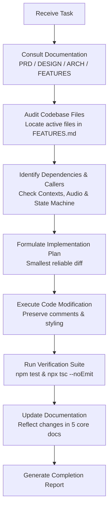

# 🤖 Regius — AI Agent Operating Manual & Instructions

> **Applies to**: Antigravity, Claude, Cursor, Copilot, and all autonomous AI coding agents  
> **Repository**: `Regius` (React Native 0.87.1 / React 19 / TypeScript 6)  
> **Source Documents**: [PRD.md](PRD.md) | [DESIGN_SYSTEM.md](DESIGN_SYSTEM.md) | [ARCHITECTURE.md](ARCHITECTURE.md) | [FEATURES.md](FEATURES.md)

---

## 1. Core Principles & Philosophy

As an AI coding agent working on **Regius**, your primary obligation is to maintain the stability, aesthetic excellence, and architectural integrity of the application.

Regius is a refined, production-grade codebase with active, finely-tuned native audio integrations, background speech recognition, real-time neural TTS, and custom gesture-driven navigation. **Casual modifications, careless refactors, or standard generic templates will break native audio pipelines and violate the luxury brand aesthetic.**

### The 11 Mandatory Agent Directives

1. **Inspect Before Modifying**: Never edit a file without reading its active implementation and understanding its callers.
2. **Root-Cause Analysis First**: When fixing a bug, identify the root cause before writing code. Never apply superficial masking patches.
3. **Smallest Reliable Change**: Make the minimal, most targeted change necessary to achieve the goal. Do not perform wholesale file rewrites when a surgical replacement suffices.
4. **Preserve Dynamic Behavior & Fallbacks**: Never remove working features, existing dynamic behavior, user preferences, or fallback mechanisms (such as bundled audio fallbacks or phonetic regexes) without explicit authorization.
5. **No Test Mocking of Real Logic**: Never replace real application logic or native service bridges with mocks simply to make tests pass.
6. **Zero Hallucination of APIs or Dependencies**: Never invent API contracts, credentials, environment variables, or completed backend features. Base all work on verifiable code.
7. **Adhere to the Design System**: Every new or edited UI component must strictly follow [DESIGN_SYSTEM.md](DESIGN_SYSTEM.md). Never use generic blue/grey colors, flat borderless tags, or clinical `#FFFFFF` canvases.
8. **Run Available Verification Checks**: Always execute `npm test` and `npx tsc --noEmit` after making changes. Report actual test counts and compiler outputs.
9. **Update Documentation Continuously**: Whenever a change impacts product requirements, architectural flow, design tokens, or feature status, immediately update [PRD.md](PRD.md), [DESIGN_SYSTEM.md](DESIGN_SYSTEM.md), [ARCHITECTURE.md](ARCHITECTURE.md), or [FEATURES.md](FEATURES.md).
10. **Explain Conflicts Transparently**: If instructions or specifications conflict with codebase realities, explain the conflict clearly rather than silently discarding existing behavior.
11. **Concise, Human-Style Comments (No AI Fluff)**: Never write multi-paragraph block comments, redundant JSDocs repeating method names, or decorative emojis. Write brief human comments only when explaining tricky or non-obvious logic; remove obvious comments and dead commented-out code.

---

## 2. Mandatory Agent Workflow

Before beginning any task, follow this exact sequence:



### Step 1: Document Consultation

- **Product & Behavioral Requirements**: Consult [PRD.md](PRD.md).
- **Colors, Fonts, Badges, Spacing**: Consult [DESIGN_SYSTEM.md](DESIGN_SYSTEM.md).
- **State Machine, Audio Session, Lifecycle**: Consult [ARCHITECTURE.md](ARCHITECTURE.md).
- **Feature Ownership & File Mappings**: Consult [FEATURES.md](FEATURES.md).

### Step 2: Codebase Inspection

- Read the relevant source files with `view_file` or `grep_search`.
- Check where components or functions are exported and consumed.
- Check if tests exist in `__tests__/` for the target module.

### Step 3: Targeted Implementation

- Apply modifications using `replace_file_content` or `multi_replace_file_content`.
- Avoid wiping existing comments, docstrings, or platform-specific guards.

### Step 4: Verification

- Run TypeScript verification: `npx tsc --noEmit`
- Run Jest test suite: `npm test`
- If modifying native layers, check iOS `Info.plist` and Android `AndroidManifest.xml`.

### Step 5: Documentation Update

- If you added a feature, register it in [FEATURES.md](FEATURES.md).
- If you modified architecture or data flow, update [ARCHITECTURE.md](ARCHITECTURE.md).
- If you added or changed design tokens, update [DESIGN_SYSTEM.md](DESIGN_SYSTEM.md).

---

## 3. Technology Stack & Directory Conventions

### 3.1 Technology Stack Standards

- **Framework**: React Native `0.87.1` (New Architecture enabled: `RCTNewArchEnabled=true`).
- **Core Runtime**: React `19.2.3`.
- **Language**: TypeScript `6.0.3` with strict mode enabled.
- **Audio & Voice Pipeline**:
  - Speech-to-Text: `@react-native-voice/voice` `v3.2.4`
  - Playback Engine: `react-native-track-player` `v4.1.2`
  - Neural TTS: Kokoro-82M (via Gradio SSE client with local bundle fallback)
  - On-Device ML Runtime: `onnxruntime-react-native` `v1.24.3` (with custom JSI patch)
- **Navigation**: React Navigation `v7` (`native-stack`, `bottom-tabs`).
- **Storage**: `@react-native-async-storage/async-storage` `v3.1.1`.
- **UI Animation**: `lottie-react-native` `v7.5.0` + React Native Animated.
- **Vector Graphics**: `react-native-svg` `v15.15.5` + `lucide-react-native` `v1.56.0`.

### 3.2 Directory Structure & Ownership Rules

```text
Regius/
├── App.tsx                     # Top-level root provider wrapper
├── index.js                    # TrackPlayer & AppRegistry entry point
├── src/
│   ├── Assets/
│   │   ├── Audio/              # Bundled fallback WAV audio assets
│   │   ├── Fonts/              # Ranade & Poppins TTF font files
│   │   ├── Images/             # SVGs and vector image components
│   │   ├── JsonAnimations/     # Holograph.json (Lottie orb)
│   │   └── StyleUtilities/     # Colors.tsx, ResponsivePixels.tsx
│   ├── Common/                 # Shared UI primitives: Badge.tsx, CustomButton.tsx
│   ├── Components/             # Modal dialogs (AddTaskModal, AddReminderModal, etc.)
│   ├── Context/                # Global contexts (TaskReminder, VoiceWakeWord, Auth, Premium)
│   ├── Navigators/             # AppNavigator, BottomTabNavigator, PlusActionSheet
│   ├── Screens/                # Screen containers (Dashboard, Tasks, Reminders, Habits, Settings)
│   ├── Services/               # Core services (Voice/, Kokoro/, WakeWord/, AudioPlayerService)
│   └── Theme/                  # ThemeContext, fonts, Typographys
└── __tests__/                  # Jest test suites (Voice, Wake Word, State Machine)
```

---

## 4. Code Standards & Patterns

### 4.1 TypeScript Conventions

- **Strict Typing Everywhere**: Never use `any` unless wrapping an un-typed third-party event payload, and even then, cast or narrow immediately.
- **Explicit Return Types**: All exported functions, hooks, and services must declare explicit return types.
- **Co-located Interfaces**: Place interfaces in a `types.ts` file within the feature folder or at the top of the service file.

### 4.2 React Native Component Guidelines

- **Use Functional Components**: `React.FC<Props>` or standard named functions with typed props.
- **Performance Optimization**: Wrap heavy callbacks in `useCallback` and computed data in `useMemo`.
- **Responsive Pixels**: Use `ResponsivePixels` from `src/Assets/StyleUtilities/ResponsivePixels.tsx` for device-proportional scaling where appropriate.
- **Safe Area Insets**: Always handle notch and bottom navigation float using `useSafeAreaInsets()`.
- **Accessibility**: Include `accessibilityRole`, `accessibilityLabel`, and honor `AccessibilityInfo.isReduceMotionEnabled`.

### 4.3 Voice & Audio Session Hygiene

The voice pipeline in Regius manages sensitive native audio hardware. Agents modifying audio code **must observe these strict constraints**:

1. **Never Record While Speaking**: Ensure `stopVoiceEngine()` is awaited before initiating speech playback through `RegiusSpeechService` or `AudioPlayerService`. This prevents the microphone from capturing the app's own voice output.
2. **Yield Audio Session**: After stopping voice recording and before starting TrackPlayer playback, introduce a 160ms–300ms pause to let `AVAudioSession` / `AudioRecord` transition cleanly.
3. **Session ID Guards**: All state machine transitions triggered from asynchronous callbacks (such as audio completion or network arrival) must check `sessionId === currentInteractionIdRef.current` to avoid stale race conditions.
4. **Guaranteed Fallback**: If remote Kokoro neural TTS synthesis times out (default 1800ms race for greetings, 20s for general speech), immediately fall back to the bundled voice asset (`voice.previewUrl`).

### 4.4 Commenting Standards (Concise & Human-Style)

- **No AI-Generated Essays**: Never write multi-paragraph block comments, repetitive JSDocs, architectural dissertations, or decorative emoji headers (e.g. `/** 🌟 ... */`).
- **Concise & Purpose-Driven**: Use short, 1-line human comments only when explaining non-obvious logic, tricky regexes, or hardware edge cases.
- **Omit Obvious Comments**: If a function or component name is self-explanatory (e.g. `navigate()`, `AppleLogoSvg`, `stop()`), omit comments entirely rather than stating the obvious.
- **No Dead Code**: Remove dead, commented-out JSX or legacy code blocks rather than leaving them in active files.

---

## 5. UI Implementation Rules

When creating or updating UI elements:

1. **Background Color**: Use `Colors.CreamBackground` (`#FFFCE3`) for light mode, `Colors.DarkBackground` (`#121417`) for dark mode.
2. **Typography Rules**:
   - High-emphasis screen headers (H1), brand moments: `Typography.h1RanadeBold` or `Typography.displayLargeRanadeBold`.
   - Cards, body text, section headers, inputs: `Typography.bodyMediumPoppinsSemiBold` or `Fonts.poppins`.
3. **Badges**:
   - **Never render flat, borderless text badges.**
   - Always import and use `<Badge />` from `src/Common/Badge.tsx`.
   - Specify the semantic variant (`purple`, `yellow`, `green`, `orange`, `red`, `neutral`).
4. **Buttons**:
   - Always use full-pill geometry (`borderRadius: 28` to `50`).
   - Use `<CustomButton />` from `src/Common/CustomButton.tsx`.
5. **Category Consistency**:
   - When introducing category cards, define all 4 facets: `bgColor`, `borderColor`, `accentColor`, and `shadowColor` (see [DESIGN_SYSTEM.md](DESIGN_SYSTEM.md#23-category-trios--semantic-accents)).
6. **Hero Bento Cards (`DailyBriefingCard`, `TaskProductivityBento`, `HabitConsistencyBento`)**:
   - **Never render thin 1px borders or subtle flat elevation on hero cards.**
   - MUST use the signature 2-layer wrapper pattern (`cardShadowWrapper` without `overflow: 'hidden'` + inner `card` with `overflow: 'hidden'`).
   - Inner card MUST have `borderWidth: 4`, `borderColor: 'rgba(255, 255, 255, 0.9)'`, `borderRadius: 24`, and `backgroundColor: Colors.NeroBlack`.
   - Shadow wrapper MUST have deep volumetric shadow: `shadowColor: '#000000'`, `shadowOffset: { width: 0, height: 10 }`, `shadowOpacity: 0.28`, `shadowRadius: 18`, `elevation: 8-10`.
   - Parent wrapper MUST use `paddingHorizontal: 10` for consistent 10px screen margin across all tabs.

---

## 6. Verification & Quality Assurance

Before concluding any development task, agents must run and report:

```bash
# 1. Verify TypeScript types without emitting bundle
npx tsc --noEmit

# 2. Run Jest test suite
npm test
```

If tests fail:

- Read the test output carefully.
- Determine whether the failure indicates a regression in application logic or an outdated test assertion.
- Fix the root cause in application logic. **Do not modify test assertions to hide broken features.**

---

## 7. Completion Report Format

Upon finishing a task, output a structured summary adhering to this format:

```markdown
### Summary of Changes

- **Files Modified / Created**: `[relative/path/to/file.tsx](file:///absolute/path/to/file.tsx)`
- **Key Enhancements**: Bulleted list of architectural and behavioral updates.

### Verification Results

- **TypeScript**: `npx tsc --noEmit` result (Exit Code, error count).
- **Jest Test Suite**: `npm test` result (Suites passed, total tests passed).

### Documentation Synchronized

- List of documentation files updated (`PRD.md`, `DESIGN_SYSTEM.md`, `ARCHITECTURE.md`, `FEATURES.md`).

### Known Limitations & Open Questions

- Any missing backend APIs, unverified platform behaviors, or follow-up items.
```
