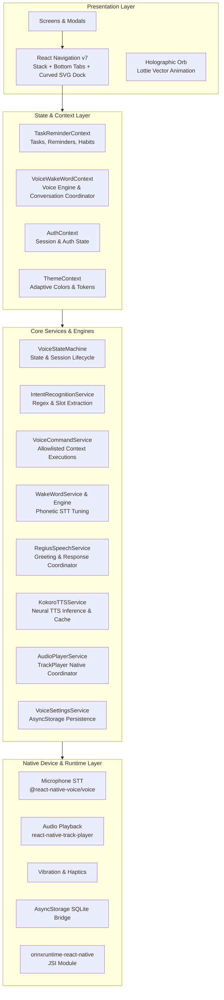
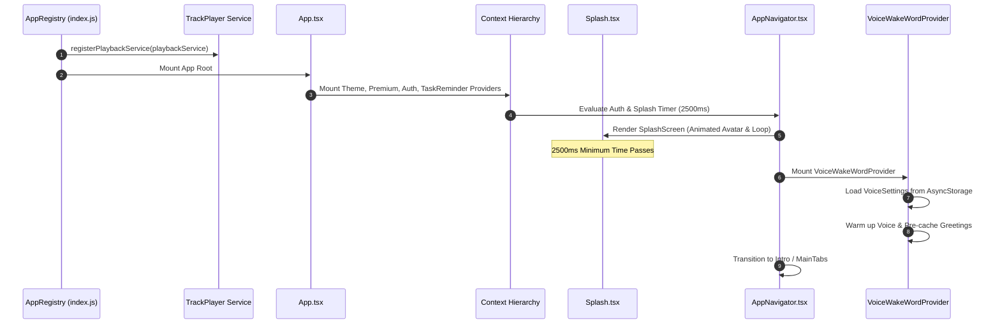
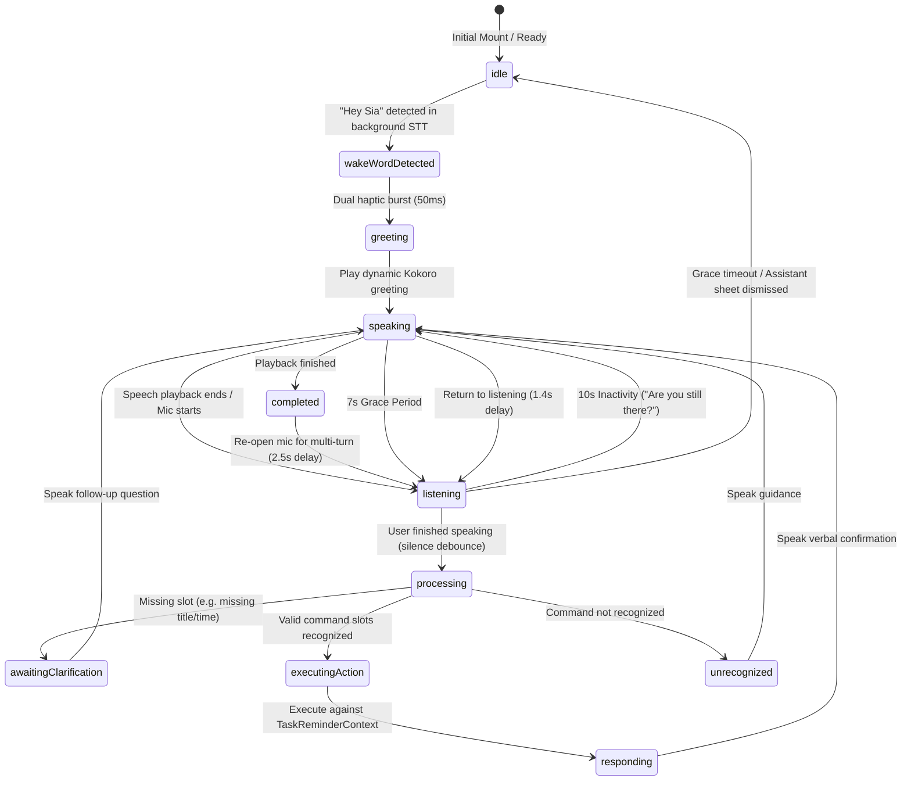
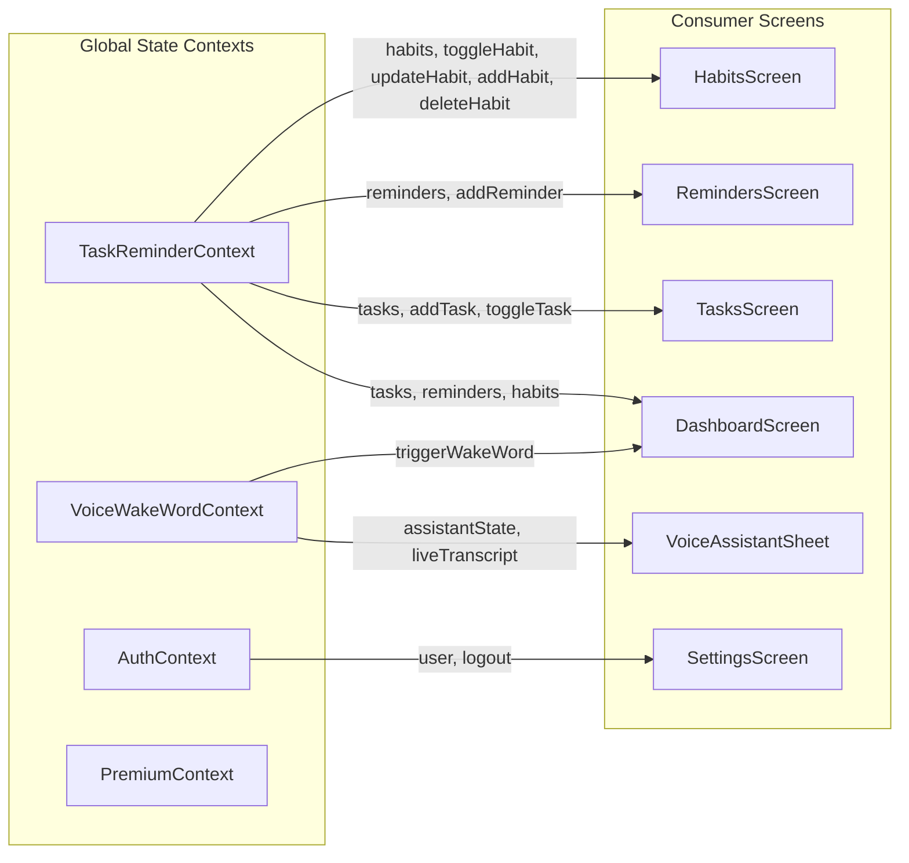

# 🏛️ Regius — Technical Architecture Specification

> **Document Status**: Active / Single Source of Truth for Engineering Architecture  
> **Target Audience**: Software Engineers, Mobile Architects, AI Coding Agents  
> **Source Documents**: [PRD.md](PRD.md) | [DESIGN_SYSTEM.md](DESIGN_SYSTEM.md) | [AGENTS.md](AGENTS.md) | [FEATURES.md](FEATURES.md)

---

## 1. System Overview & Technology Stack

Regius is built on the modern React Native framework with the **New Architecture** enabled (`RCTNewArchEnabled=true`), targeting iOS and Android with strict TypeScript typing.



### 1.1 Dependency & Toolchain Inventory

| Package / Library                           | Version    | Technical Purpose                                        |
| :------------------------------------------ | :--------- | :------------------------------------------------------- |
| `react`                                     | `19.2.3`   | Core UI library                                          |
| `react-native`                              | `0.87.1`   | Mobile runtime with New Architecture JSI enabled         |
| `typescript`                                | `6.0.3`    | Static type checking and compiler verification           |
| `@react-navigation/native`                  | `^7.5.0`   | Navigation container and routing ref                     |
| `@react-navigation/native-stack`            | `^7.20.0`  | High-performance native stack screen transitions         |
| `@react-navigation/bottom-tabs`             | `^7.20.0`  | Custom curved SVG floating bottom navigation bar         |
| `@react-native-voice/voice`                 | `^3.2.4`   | Background wake word detection & live streaming STT      |
| `react-native-track-player`                 | `^4.1.2`   | Native audio playback engine (`AVPlayer` / `ExoPlayer`)  |
| `onnxruntime-react-native`                  | `^1.24.3`  | On-device neural model inference runtime (JSI patched)   |
| `lottie-react-native`                       | `^7.5.0`   | High-fidelity vector rendering for `Holograph.json`      |
| `lucide-react-native`                       | `^1.56.0`  | Consistent vector iconography                            |
| `react-native-svg`                          | `^15.15.5` | Curved bottom bar rendering and inline SVG illustrations |
| `@react-native-async-storage/async-storage` | `^3.1.1`   | Local SQLite/file key-value persistence                  |
| `react-native-toast-message`                | `^2.5.2`   | Global tactile toast notifications                       |

---

## 2. Repository & Source Directory Structure

```text
Regius/
├── App.tsx                     # Top-level root provider hierarchy
├── index.js                    # Native AppRegistry & TrackPlayer playback registration
├── package.json                # Dependencies, engines (Node >= 22.11.0), and scripts
├── tsconfig.json               # TypeScript strict configuration
├── patches/                    # Patches for onnxruntime JSI and dev-middleware
├── ios/                        # Native Xcode project, Info.plist, Podfile
├── android/                    # Native Android project, Manifest, Gradle config
├── __tests__/                  # Unit and integration test suites
└── src/
    ├── Assets/
    │   ├── Audio/              # Bundled fallback WAV audio assets (af_bella, am_adam, etc.)
    │   ├── Fonts/              # Ranade & Poppins custom typography assets
    │   ├── Images/             # SVGs and vector image components
    │   ├── JsonAnimations/     # Holograph.json Lottie animation
    │   └── StyleUtilities/     # Colors.tsx, ResponsivePixels.tsx
    ├── Common/                 # Shared UI primitives (Badge.tsx, CustomButton.tsx, Toast)
    ├── Components/             # Modal components (AddTaskModal, AddReminderModal, AddHabitModal)
    ├── Context/                # Global React contexts (TaskReminder, VoiceWakeWord, Auth, Premium)
    ├── Navigators/             # AppNavigator.tsx, BottomTabNavigator.tsx, PlusActionSheet.tsx
    ├── Screens/                # Screen implementations (Dashboard, Tasks, Reminders, Habits, Settings, Login, Intro, Splash)
    ├── Services/               # Core business services:
    │   ├── AudioPlayerService.ts      # Native TrackPlayer coordinator
    │   ├── playbackService.ts         # Headless TrackPlayer background receiver
    │   ├── RegiusSpeechService.ts     # Speech synthesis facade and wake greetings
    │   ├── VoiceSettingsService.ts    # AsyncStorage persistence for user settings
    │   ├── DailyQuotes/               # Deterministic PRNG daily footer quotes & midnight rollover
    │   ├── Kokoro/                    # Kokoro-82M neural TTS synthesis & cache
    │   ├── Voice/                     # State machine, intent recognition, command execution
    │   └── WakeWord/                  # Wake word detection engine and presets
    ├── Theme/                  # ThemeContext.tsx, fonts.ts, Typographys.ts
    └── api/                    # Scaffolding for planned backend integrations
```

---

## 3. Application Initialization & Lifecycle



### 3.1 Entry Point Execution (`index.js` & `App.tsx`)

1. **Headless Service Registration**: `TrackPlayer.registerPlaybackService(() => playbackService)` is registered at top-level before `AppRegistry.registerComponent`.
2. **Provider Wrapping Order** in [App.tsx](file:///Users/renishbhuva/Documents/Development/React_Native/Regius/App.tsx):
   ```tsx
   <ThemeProvider>
     <PremiumProvider>
       <AuthProvider>
         <TaskReminderProvider>
           <SafeAreaProvider>
             <AppNavigator />
             <Toast config={toastConfig} />
           </SafeAreaProvider>
         </TaskReminderProvider>
       </AuthProvider>
     </PremiumProvider>
   </ThemeProvider>
   ```
3. **Splash Timer Gate**: `AppNavigator` enforces a minimum 2500ms display timer for `Splash.tsx` to ensure brand presence and allow background voice settings to load cleanly from `AsyncStorage`.

---

## 4. Voice Assistant & Multimodal Conversational Architecture

The voice assistant is the architectural centerpiece of Regius. It integrates wake-word detection, speech recognition, a formal state machine, neural speech synthesis, and state execution.

### 4.1 State Machine Lifecycle (`VoiceStateMachine.ts`)



### 4.2 Wake Word Detection Engine (`WakeWordDetectionEngine.ts`)

- **Engine**: Consumes `@react-native-voice/voice` continuous background streaming.
- **Native Patch & SFSpeechAudioBufferRecognitionRequest Guard**: Patched via `patch-package` (`patches/@react-native-voice+voice+3.2.4.patch`) to serialize iOS `startSpeech:` invocations onto the main queue, prevent concurrent recognition requests, handle session de-multiplexing safely without terminating new sessions on stale result callbacks, and catch native `NSInternalInconsistencyException` exceptions.
- **Context Mutex & Fast-Refresh Resilience**: `VoiceWakeWordContext.tsx` enforces strict `isStartingRef` exclusion and suppresses redundant voice engine teardowns when already actively listening in idle state.
- **Phonetic STT Tuning**: Because mobile STT engines frequently transcribe names phonetically or imperfectly, the engine evaluates transcripts against compiled regex patterns with extensive phonetic aliases (e.g., `sia`, `siya`, `see ya`, `ceeya`, `cera`, `regius`, `regis`, `reach us`, `ready us`).
- **Cooldown Guard**: Enforces a 2500ms cooldown window between wake triggers to prevent double-firing.
- **Haptic Feedback**: Immediately triggers dual haptic pulses (iOS: 50ms; Android: `[0, 50, 40, 70]`) upon detection.

### 4.3 Neural Text-to-Speech Architecture (`KokoroTTSService.ts`)

The TTS pipeline produces human-grade, natural 24kHz speech using Kokoro-82M:

1. **Persistent Synthesis Cache**: Memory `Map` backed by `AsyncStorage` (`@regius_kokoro_audio_cache_v2`). If a phrase was previously synthesized for the active voice and speed, it resolves in **0ms**.
2. **Background Voice Warmup**: On application startup or when switching voices, `RegiusSpeechService.warmupVoice()` pre-synthesizes wake greetings in the background.
3. **Cloud Neural Inference**: Sends text to HuggingFace Gradio SSE queue endpoint (`https://hexgrad-kokoro-tts.hf.space/gradio_api/queue/`).
4. **Guaranteed Local Fallback**: If remote inference exceeds the timeout threshold (1800ms for greetings, 20s for arbitrary sentences), the system automatically plays the high-quality bundled voice asset from `src/Assets/Audio/` (`af_bella.wav`, `af_nicole.wav`, etc.). Playback **never fails silently**.

### 4.4 Conversational Command Interpretation & Execution

- **`IntentRecognitionService.ts`**: Analyzes spoken text, extracts parameters (title, date, time, category, priority, frequency), and detects missing required slots.
- **Slot Clarification**: If a required parameter is missing (e.g., user says _"Add a task"_ without a title), the system constructs a `PendingClarification` object and prompts the user verbally.
- **Allowlisted Execution**: `VoiceCommandService.execute()` validates parameters and modifies `TaskReminderContext` using safe, synchronous operations.

---

## 5. State Management & Data Flow Architecture



### 5.1 Context Roles & Scopes

1. **`TaskReminderContext`**:
   - Manages in-memory state for `tasks`, `reminders`, and `habits`.
   - Exposes modal control functions (`openTaskModal`, `closeTaskModal`, etc.).
   - Provides item toggle and creation methods with auto-generated IDs and date stamps.
2. **`VoiceWakeWordContext`**:
   - Maintains the centralized `VoiceStateMachine` instance.
   - Manages the native Voice STT lifecycle and restarts.
   - Coordinates with `RegiusSpeechService` and `AudioPlayerService`.
   - Mounts and controls `VoiceAssistantSheet`.
3. **`VoiceSettingsService`**:
   - Persists user preferences (`selectedVoiceId`, `speechSpeed`, `autoSpeakReplies`, `wakeWordPhrase`, `wakeWordEnabled`) to `AsyncStorage`.
4. **`AuthContext` & `PremiumContext`**:
   - Maintain authentication status, user profile, and subscription gating. (Currently operating as local in-memory providers).

---

## 6. Native & Platform Integrations

### 6.1 iOS Platform Specifics

- **Speech & Microphone Permissions**: Specified in `ios/Regius/Info.plist`:
  - `NSMicrophoneUsageDescription`: Hands-free wake word detection and voice commands.
  - `NSSpeechRecognitionUsageDescription`: Speech-to-text processing.
- **Audio Session Handling**: `react-native-track-player` configures `AVAudioSessionCategoryPlayback`. When voice recording ends, a 160ms–300ms pause is enforced to allow `AVAudioSession` to release `playAndRecord` mode cleanly before TrackPlayer plays audio.
- **New Architecture & JSI**: Enabled (`RCTNewArchEnabled = true`). The `onnxruntime-react-native` package includes a custom patch (`patches/onnxruntime-react-native+1.24.3.patch`) ensuring bridge runtime resolution compatibility.

### 6.2 Android Platform Specifics

- **Permissions**: Specified in `android/app/src/main/AndroidManifest.xml`:
  - `android.permission.RECORD_AUDIO`: Runtime permission requested via `PermissionsAndroid.request()` in `VoiceWakeWordContext.tsx`.
  - `android.permission.INTERNET`: For cloud neural TTS synthesis.
- **Haptic Vibration**: Uses `Vibration.vibrate([0, 50, 40, 70])` to produce a tactile double-buzz pattern.

---

## 7. Testing Strategy & Verification Pipeline

Regius enforces automated test verification across conversational flows, state machine transitions, and speech services.

### Test Suite Structure (`__tests__/`)

| Test File                                | Verification Scope                                                     | Tests |
| :--------------------------------------- | :--------------------------------------------------------------------- | :---- |
| `WakeWordDetection.test.ts`              | Regex matching, phonetic alias recognition, cooldown logic             | 12    |
| `VoiceStateMachine.test.ts` / Suite      | Valid state transitions, session isolation, stale callback guards      | 24    |
| `VoiceCommandService.test.ts`            | Intent classification, slot extraction, allowlist execution            | 18    |
| `VoiceConfirmationBuilder.test.ts`       | Verbal confirmation phrasing, error messaging                          | 14    |
| `VoiceAssistantConversationFlow.test.ts` | End-to-end multi-turn dialogue, silence debounce, session reset        | 22    |
| `VoiceAssistantGreetingPlayback.test.ts` | Dynamic greeting resolution, cache hit, audio lifecycle callbacks      | 16    |
| `ConversationalVoiceAssistant.test.ts`   | Slot clarification, cancellation, inactivity timeouts                  | 14    |
| `VoiceAssistantSheet.test.tsx`           | UI sheet rendering, Lottie orb coordination, mic controls              | 10    |
| `DashboardRedesign.test.tsx`             | Metrics, chronological flow, scooped card SVG, scroll layer & logotype | 17    |

### 7.1 Scroll-Reactive Layer Header Architecture (`DashboardScreen.tsx`)

- Uses `useRef(new Animated.Value(0)).current` with `Animated.event` to drive visual transitions without bridge bottlenecks.
- Smoothly animates `backgroundColor` from `#FBF9F3` to `Colors.LavenderPurple` (`#8383D6`), `borderBottomLeftRadius` & `borderBottomRightRadius` from `0` to `24`, `shadowOpacity` from `0` to `0.22`, and `paddingBottom` from `0` to `14px` (`headerPaddingBottom`) for cushion around controls.
- Tracks active threshold state via `isScrolledRef.current` to synchronously toggle `StatusBar` (`dark-content` ↔ `light-content`), `RegiusLogo` (`default` ↔ `light`), and button styling with zero closure lag.
- Employs absolute positioning (`position: 'absolute', top: 0, left: 0, right: 0, zIndex: 100`) and dynamic safe-area insets (`paddingTop: insets.top`) so the scrolling viewport glides behind the rounded bottom layer.

### Build & Verification Commands

```bash
# Static type checking
npx tsc --noEmit

# Unit & integration testing
npm test

# Code quality & formatting
npm run lint
```

---

## 8. Technical Debt, Risks & Proposed Improvements

1. **Task / Reminder Persistence**: `TaskReminderContext` currently initializes from in-memory seed data.  
   _Proposed Improvement_: Hydrate and persist `tasks`, `reminders`, and `habits` to `AsyncStorage` on every mutation.
2. **OS-Level Scheduled Notifications**: The app currently stores reminder times in memory, but no background alarms or native notifications are scheduled.  
   _Proposed Improvement_: Integrate `@notifee/react-native` to schedule local notification triggers.
3. **On-Device ONNX Kokoro TTS**: Cloud synthesis requires network connectivity.  
   _Proposed Improvement_: Bundle Kokoro-82M ONNX model weights and run offline inference via `onnxruntime-react-native`.
4. **Backend API Scaffolding**: `src/api/` folders are currently empty placeholders.  
   _Proposed Improvement_: Implement REST/GraphQL client with JWT authentication and offline-first synchronization.
