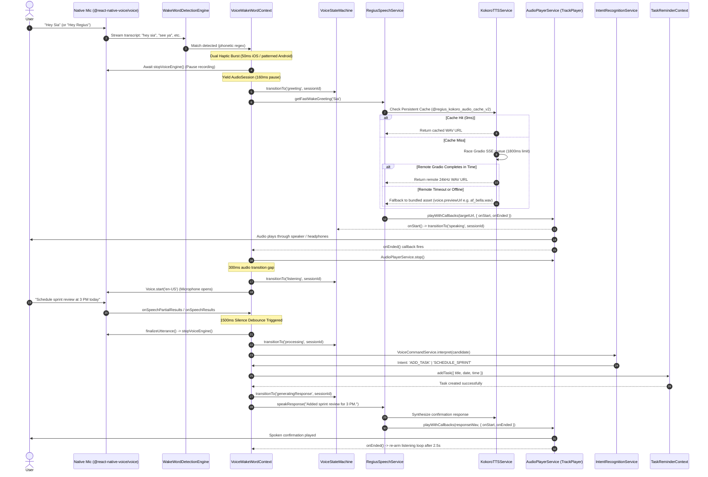

# 📋 Regius — Feature & Integration Registry

> **Document Status**: Active / Single Source of Truth for Feature Implementation  
> **Target Audience**: AI Agents (Antigravity), Engineers, Product Managers  
> **Source Documents**: [PRD.md](PRD.md) | [DESIGN_SYSTEM.md](DESIGN_SYSTEM.md) | [ARCHITECTURE.md](ARCHITECTURE.md) | [AGENTS.md](AGENTS.md)

---

## 1. Quick Feature-to-File Navigation Matrix

Use this lookup table to identify exactly which files, components, hooks, and services to inspect before modifying any feature.

| Feature Area                  | Status        | Primary Component / Screen                                                                                                         | Service / Context / Engine                                                                                                                | Key Source Files                                                                                                                                                                                                                                                                                                                                                                                                                                                                                                                                                                                                    |
| :---------------------------- | :------------ | :--------------------------------------------------------------------------------------------------------------------------------- | :---------------------------------------------------------------------------------------------------------------------------------------- | :------------------------------------------------------------------------------------------------------------------------------------------------------------------------------------------------------------------------------------------------------------------------------------------------------------------------------------------------------------------------------------------------------------------------------------------------------------------------------------------------------------------------------------------------------------------------------------------------------------------ |
| **Wake-Word Activation**      | `Implemented` | `BottomTabNavigator.tsx`, `DashboardScreen.tsx`                                                                                    | `VoiceWakeWordContext.tsx`, `WakeWordService.ts`                                                                                          | [VoiceWakeWordContext.tsx](file:///Users/renishbhuva/Documents/Development/React_Native/Regius/src/Context/VoiceWakeWordContext.tsx), [WakeWordPresets.ts](file:///Users/renishbhuva/Documents/Development/React_Native/Regius/src/Services/WakeWord/WakeWordPresets.ts)                                                                                                                                                                                                                                                                                                                                            |
| **Holographic Assistant UI**  | `Implemented` | `VoiceAssistantSheet.tsx`, `SiaHolographicOrb.tsx`                                                                                 | `VoiceStateMachine.ts`, `Holograph.json`                                                                                                  | [VoiceAssistantSheet.tsx](file:///Users/renishbhuva/Documents/Development/React_Native/Regius/src/Screens/Dashboard/Components/VoiceAssistantSheet.tsx), [SiaHolographicOrb.tsx](file:///Users/renishbhuva/Documents/Development/React_Native/Regius/src/Screens/Dashboard/Components/SiaHolographicOrb.tsx)                                                                                                                                                                                                                                                                                                        |
| **Dynamic Greetings & TTS**   | `Implemented` | `VoiceAssistantSheet.tsx`                                                                                                          | `RegiusSpeechService.ts`, `KokoroTTSService.ts`                                                                                           | [RegiusSpeechService.ts](file:///Users/renishbhuva/Documents/Development/React_Native/Regius/src/Services/RegiusSpeechService.ts), [KokoroTTSService.ts](file:///Users/renishbhuva/Documents/Development/React_Native/Regius/src/Services/Kokoro/KokoroTTSService.ts)                                                                                                                                                                                                                                                                                                                                               |
| **Command Interpretation**    | `Implemented` | `LiveTranscript.tsx`, `AssistantStatus.tsx`                                                                                        | `IntentRecognitionService.ts`, `VoiceCommandService.ts`                                                                                   | [IntentRecognitionService.ts](file:///Users/renishbhuva/Documents/Development/React_Native/Regius/src/Services/Voice/IntentRecognitionService.ts), [VoiceCommandService.ts](file:///Users/renishbhuva/Documents/Development/React_Native/Regius/src/Services/Voice/VoiceCommandService.ts)                                                                                                                                                                                                                                                                                                                          |
| **Slot Clarification Loop**   | `Implemented` | `ClarificationPrompt.tsx`, `ActionConfirmation.tsx`                                                                                | `VoiceCommandService.ts`, `VoiceConfirmationBuilder.ts`                                                                                   | [VoiceConfirmationBuilder.ts](file:///Users/renishbhuva/Documents/Development/React_Native/Regius/src/Services/Voice/VoiceConfirmationBuilder.ts)                                                                                                                                                                                                                                                                                                                                                                                                                                                                   |
| **Voice Studio & Profiles**   | `Implemented` | `VoiceStudioModal.tsx`, `DefaultVoiceSection.tsx`                                                                                  | `VoiceSettingsService.ts`, `VOICES` registry                                                                                              | [SettingsScreen.tsx](file:///Users/renishbhuva/Documents/Development/React_Native/Regius/src/Screens/Settings/SettingsScreen.tsx), [VoiceSettingsService.ts](file:///Users/renishbhuva/Documents/Development/React_Native/Regius/src/Services/VoiceSettingsService.ts)                                                                                                                                                                                                                                                                                                                                              |
| **Task Management**           | `Implemented` | `TasksScreen.tsx`, `AddTaskModal.tsx`                                                                                              | `TaskReminderContext.tsx`                                                                                                                 | [TasksScreen.tsx](file:///Users/renishbhuva/Documents/Development/React_Native/Regius/src/Screens/Tasks/TasksScreen.tsx), [TaskReminderContext.tsx](file:///Users/renishbhuva/Documents/Development/React_Native/Regius/src/Context/TaskReminderContext.tsx)                                                                                                                                                                                                                                                                                                                                                        |
| **Reminder Management**       | `Implemented` | `RemindersScreen.tsx`, `AddReminderModal.tsx`                                                                                      | `TaskReminderContext.tsx`                                                                                                                 | [RemindersScreen.tsx](file:///Users/renishbhuva/Documents/Development/React_Native/Regius/src/Screens/Reminders/RemindersScreen.tsx)                                                                                                                                                                                                                                                                                                                                                                                                                                                                                |
| **Habit Streak Tracking**     | `Implemented` | `HabitsScreen.tsx`, `AddHabitModal.tsx`                                                                                            | `TaskReminderContext.tsx`                                                                                                                 | [HabitsScreen.tsx](file:///Users/renishbhuva/Documents/Development/React_Native/Regius/src/Screens/Habits/HabitsScreen.tsx)                                                                                                                                                                                                                                                                                                                                                                                                                                                                                         |
| **Curated Flow Timeline**     | `Implemented` | `DashboardScreen.tsx`, `TimelineItemCard.tsx`, `FlowBadgePatternSvg.tsx`, `FlowSectionBackgroundSvg.tsx`                           | 3D Filter Capsules, `TaskReminderContext.tsx`, `FlowBadgePatternSvg` crest & `FlowSectionBackgroundSvg` luxury background                 | [DashboardScreen.tsx](file:///Users/renishbhuva/Documents/Development/React_Native/Regius/src/Screens/Dashboard/DashboardScreen.tsx), [TimelineItemCard.tsx](file:///Users/renishbhuva/Documents/Development/React_Native/Regius/src/Screens/Dashboard/Components/TimelineItemCard.tsx), [FlowBadgePatternSvg.tsx](file:///Users/renishbhuva/Documents/Development/React_Native/Regius/src/Screens/Dashboard/Components/FlowBadgePatternSvg.tsx), [FlowSectionBackgroundSvg.tsx](file:///Users/renishbhuva/Documents/Development/React_Native/Regius/src/Screens/Dashboard/Components/FlowSectionBackgroundSvg.tsx) |
| **Scroll-Reactive Header**    | `Implemented` | `ScreenHeader.tsx`, `DashboardScreen.tsx`, `HabitsScreen.tsx`, `HeaderPatternSvg.tsx`                                              | `Animated.event`, `Colors.LavenderPurple`, Theme SVG background pattern, Title & Subtitle, Voice Orb, Tactile Avatar Ring                 | [ScreenHeader.tsx](file:///Users/renishbhuva/Documents/Development/React_Native/Regius/src/Common/ScreenHeader.tsx), [DashboardScreen.tsx](file:///Users/renishbhuva/Documents/Development/React_Native/Regius/src/Screens/Dashboard/DashboardScreen.tsx), [HabitsScreen.tsx](file:///Users/renishbhuva/Documents/Development/React_Native/Regius/src/Screens/Habits/HabitsScreen.tsx), [HeaderPatternSvg.tsx](file:///Users/renishbhuva/Documents/Development/React_Native/Regius/src/Screens/Dashboard/Components/HeaderPatternSvg.tsx)                                                                           |
| **Playable Morning Brief**    | `Implemented` | `DailyBriefingCard.tsx`                                                                                                            | `AudioPlayerService.ts`, `KokoroTTSService.ts`                                                                                            | [DailyBriefingCard.tsx](file:///Users/renishbhuva/Documents/Development/React_Native/Regius/src/Screens/Dashboard/Components/DailyBriefingCard.tsx), [AudioPlayerService.ts](file:///Users/renishbhuva/Documents/Development/React_Native/Regius/src/Services/AudioPlayerService.ts)                                                                                                                                                                                                                                                                                                                                |
| **Regius Logotype & Crest**   | `Implemented` | `RegiusLogo.tsx`, `DashboardScreen.tsx`                                                                                            | Crown Crest SVG, `Fonts.transcity` (Transcity Demo), Radiant Sparkle                                                                      | [RegiusLogo.tsx](file:///Users/renishbhuva/Documents/Development/React_Native/Regius/src/Common/RegiusLogo.tsx), [index.ts](file:///Users/renishbhuva/Documents/Development/React_Native/Regius/src/Common/index.ts)                                                                                                                                                                                                                                                                                                                                                                                                |
| **Curved Floating Dock**      | `Implemented` | `BottomTabNavigator.tsx`, `BottomTabPatternSvg.tsx`, `FocusedTabPatternSvg.tsx`, `PlusButtonPatternSvg.tsx`, `PlusActionSheet.tsx` | Custom SVG Path, Floating Dock Aesthetic Pattern SVG, Focused Tab Indicator Pattern, Plus Button Aesthetic Pattern, React Native Animated | [BottomTabNavigator.tsx](file:///Users/renishbhuva/Documents/Development/React_Native/Regius/src/Navigators/BottomTabNavigator.tsx), [BottomTabPatternSvg.tsx](file:///Users/renishbhuva/Documents/Development/React_Native/Regius/src/Navigators/BottomTabPatternSvg.tsx), [FocusedTabPatternSvg.tsx](file:///Users/renishbhuva/Documents/Development/React_Native/Regius/src/Navigators/FocusedTabPatternSvg.tsx), [PlusButtonPatternSvg.tsx](file:///Users/renishbhuva/Documents/Development/React_Native/Regius/src/Navigators/PlusButtonPatternSvg.tsx)                                                        |
| **3D Upper-Layer Badges**     | `Implemented` | `Badge.tsx`                                                                                                                        | `Platform.select`, `VARIANT_CONFIGS`                                                                                                      | [Badge.tsx](file:///Users/renishbhuva/Documents/Development/React_Native/Regius/src/Common/Badge.tsx)                                                                                                                                                                                                                                                                                                                                                                                                                                                                                                               |
| **Onboarding & Splash**       | `Implemented` | `Splash.tsx`, `Intro.tsx`                                                                                                          | `AppNavigator.tsx`, Animated timer gate                                                                                                   | [Splash.tsx](file:///Users/renishbhuva/Documents/Development/React_Native/Regius/src/Screens/Splash/Splash.tsx), [Intro.tsx](file:///Users/renishbhuva/Documents/Development/React_Native/Regius/src/Screens/Intro/Intro.tsx)                                                                                                                                                                                                                                                                                                                                                                                       |
| **Local Settings Storage**    | `Implemented` | `SettingsScreen.tsx`                                                                                                               | `@react-native-async-storage/async-storage`                                                                                               | [VoiceSettingsService.ts](file:///Users/renishbhuva/Documents/Development/React_Native/Regius/src/Services/VoiceSettingsService.ts)                                                                                                                                                                                                                                                                                                                                                                                                                                                                                 |
| **Task/Habit Storage**        | `Partial`     | In-memory `TaskReminderContext`                                                                                                    | Local React State (not persisted to disk)                                                                                                 | [TaskReminderContext.tsx](file:///Users/renishbhuva/Documents/Development/React_Native/Regius/src/Context/TaskReminderContext.tsx)                                                                                                                                                                                                                                                                                                                                                                                                                                                                                  |
| **OS Reminder Notifications** | `Planned`     | In-memory `time` & `date` strings                                                                                                  | Needs `@notifee/react-native` or native alarms                                                                                            | [RemindersScreen.tsx](file:///Users/renishbhuva/Documents/Development/React_Native/Regius/src/Screens/Reminders/RemindersScreen.tsx)                                                                                                                                                                                                                                                                                                                                                                                                                                                                                |
| **On-Device ONNX TTS**        | `Partial`     | `KokoroTTSService.ts`                                                                                                              | `onnxruntime-react-native` (patched, model pending)                                                                                       | [KokoroTTSService.ts](file:///Users/renishbhuva/Documents/Development/React_Native/Regius/src/Services/Kokoro/KokoroTTSService.ts)                                                                                                                                                                                                                                                                                                                                                                                                                                                                                  |
| **Cloud Backend Sync**        | `Planned`     | `src/api/` folders (controllers/helpers)                                                                                           | Remote REST / GraphQL sync (empty scaffolding)                                                                                            | [src/api/](file:///Users/renishbhuva/Documents/Development/React_Native/Regius/src/api)                                                                                                                                                                                                                                                                                                                                                                                                                                                                                                                             |
| **Subscription Payments**     | `Partial`     | `PremiumContext.tsx`                                                                                                               | In-memory mock boolean (`isPremium`)                                                                                                      | [PremiumContext.tsx](file:///Users/renishbhuva/Documents/Development/React_Native/Regius/src/Context/PremiumContext.tsx)                                                                                                                                                                                                                                                                                                                                                                                                                                                                                            |

---

## 2. Detailed Feature Registry

### 2.1 Voice Assistant & Wake-Word Activation

- **Purpose**: Hands-free acoustic detection of the configured wake phrase to summon the assistant.
- **Status**: `Implemented`
- **Source Files**:
  - `src/Context/VoiceWakeWordContext.tsx`
  - `src/Services/WakeWord/WakeWordService.ts`
  - `src/Services/WakeWord/WakeWordDetectionEngine.ts`
  - `src/Services/WakeWord/WakeWordPresets.ts`
- **Native Modules & Providers**: `@react-native-voice/voice` (Continuous speech recognition loop), `Vibration` (Dual haptics).
- **User-Facing Workflow**:
  1. User speaks _"Hey Sia"_ (or configured preset: Regius, Aria, Nova, Jarvis, Echo).
  2. Background recognition catches acoustic match using phonetic tuning regexes.
  3. Device vibrates with dual haptic feedback.
  4. Audio engine yields 160ms, transitions state to `greeting`, and opens `VoiceAssistantSheet`.
- **Permissions Required**: iOS: `NSMicrophoneUsageDescription`, `NSSpeechRecognitionUsageDescription`; Android: `RECORD_AUDIO`.
- **Fallback Behavior**: Long-press on the center floating plus button (320ms) activates assistant manually if microphone is muted or in noisy environments.
- **Test Coverage**: Tested in `__tests__/WakeWordDetection.test.ts` (12 tests) and `__tests__/VoiceAssistantConversationFlow.test.ts`.

---

### 2.2 Dynamic Greetings & Neural TTS Playback

- **Purpose**: Generate and speak natural, warm vocal greetings and responses in the user's selected neural voice.
- **Status**: `Implemented`
- **Source Files**:
  - `src/Services/RegiusSpeechService.ts`
  - `src/Services/Kokoro/KokoroTTSService.ts`
  - `src/Services/Voice/wakeWordReplies.ts`
  - `src/Services/AudioPlayerService.ts`
  - `src/Assets/Audio/index.ts`
- **Native Modules & Providers**: `react-native-track-player`, HuggingFace Gradio SSE queue endpoint (`https://hexgrad-kokoro-tts.hf.space/`).
- **User-Facing Workflow**:
  1. Assistant selects greeting variation (e.g. _"Hey there! Sia here, ready when you are"_).
  2. Checks local persistent cache for 0ms instant playback.
  3. If uncached, races remote neural inference (1800ms threshold for greetings).
  4. Plays high-quality audio through TrackPlayer; updates Holographic Orb to breathing speaking state.
- **Fallback Behavior**: If network is slow or offline, immediately falls back to bundled voice audio (`src/Assets/Audio/af_bella.wav`, etc.).
- **Test Coverage**: Tested in `__tests__/VoiceAssistantGreetingPlayback.test.ts` (16 tests).

---

### 2.2.1 Deep Dive: End-to-End Voice & Neural TTS System Integration ("Hey Sia" to Spoken Confirmation)

This section provides an exact, step-by-step technical breakdown of how the voice pipeline is wired across native modules, background services, state machine transitions, neural TTS synthesis, and command execution.

#### 1. End-to-End Sequence Diagram



#### 2. Ten-Step End-to-End Implementation Workflow

##### Step 1: Bootstrapping & Audio Engine Registration

- In `index.js`, `TrackPlayer.registerPlaybackService(() => playbackService)` registers headless audio events before root components mount.
- On mount, `AudioPlayerService.setup()` initializes TrackPlayer with `Capability.Play`, `Capability.Pause`, `Capability.Stop`, and `autoHandleInterruptions: true`.
- In `App.tsx`, `AppNavigator` initializes `VoiceWakeWordProvider` after the 2500ms splash display gate, loading user preferences (active voice, speech speed, wake phrase) from `VoiceSettingsService`.

##### Step 2: Background Voice Warmup

- Immediately upon resolving the active voice in `RegiusSpeechService.warmupVoice()`, the app calls `KokoroTTSService.prewarm()`.
- Predefined wake replies (`wakeWordReplies.ts`) are pre-synthesized in the background and stored in `AsyncStorage` (`@regius_kokoro_audio_cache_v2`). When the user later says "Hey Sia", the greeting audio is already cached, resolving in **0ms**.

##### Step 3: Passive Background Wake Word Listening

- In `VoiceWakeWordContext.tsx`, `startWakeWordEngine()` activates `@react-native-voice/voice` in `en-US` continuous listening mode.
- Incoming partial and final transcripts are evaluated in `WakeWordDetectionEngine.ts` against compiled regex patterns.
- **Phonetic STT Tuning**: Because acoustic recognition varies by accent and background noise, the pattern for `Hey Sia` contains extensive phonetic aliases:
  ```typescript
  /\b(?:hey|hay|hi|hello|ok|okay|ay|he)?\s*(?:sia|siya|siri|sierra|see\s+ya|seeya|ceea|ceeya|cia|shia|cyan|syra|cera|seri|seera|saya|shya|cira|sera)\b/i;
  ```
- A **2500ms cooldown timestamp guard** (`lastTriggerTimeRef`) prevents duplicate triggers from multiple partial results.

##### Step 4: Haptic Feedback & Audio Session Muting

- Upon wake detection, the app triggers a dual haptic burst:
  - iOS: `Vibration.vibrate(50)`
  - Android: `Vibration.vibrate([0, 50, 40, 70])`
- `stateMachineRef.current.startNewSession()` generates a unique `sessionId` (e.g., `vas_179234...`).
- The microphone is **immediately paused** via `await stopVoiceEngine()`.
- An explicit **160ms yield pause** (`setTimeout`) allows the native `AVAudioSession` / `AudioRecord` hardware to release recording mode before TrackPlayer initiates playback.

##### Step 5: Dynamic Greeting Resolution & Kokoro TTS Synthesis

- `RegiusSpeechService.getFastWakeGreeting('Sia')` picks a pre-warmed greeting from `wakeWordReplies.ts` (e.g., _"Hey there! Sia here, ready when you are"_).
- `KokoroTTSService.speakGreetingAndWait()` evaluates audio availability:
  1. **Cache Hit**: Plays cached WAV immediately (0ms latency).
  2. **Cache Miss**: Joins the HuggingFace Gradio queue (`https://hexgrad-kokoro-tts.hf.space/gradio_api/queue/join`) and consumes the SSE data stream (`streamGradioQueue()`) with an 1800ms race timeout.
  3. **Guaranteed Local Fallback**: If the network is unreachable or remote synthesis exceeds 1800ms, it falls back instantly to the bundled local audio asset (`src/Assets/Audio/af_bella.wav`).

##### Step 6: Native Audio Playback via TrackPlayer

- `AudioPlayerService.playWithCallbacks()` resets TrackPlayer, adds the playable WAV URL/asset, and starts playback.
- State machine transitions cleanly: `greeting` → `speaking`.
- The central `SiaHolographicOrb` synchronizes its Lottie animation speed to `1.25x` during speech.
- `onEnded()` fires natively when the audio buffer completes. TrackPlayer is explicitly stopped, and a 300ms transition pause is applied.

##### Step 7: Command Listening Session & Utterance Accumulation

- Microphone capture restarts for command capture (`Voice.start('en-US')`).
- State machine transitions to `listening`. `SiaHolographicOrb` adjusts playback speed to `1.35x`.
- In `Voice.onSpeechPartialResults`, candidate transcripts stream in real-time to `liveTranscript` in the UI.
- **Utterance Debounce Timer**: Every speech event resets a 1500ms silence timer (`silenceTimerRef`). Once the user stops speaking for 1.5 seconds, `finalizeUtterance()` triggers.
- **Max Utterance Safety Guard**: A 20-second timeout ensures continuous background noise does not hang the listening state indefinitely.

##### Step 8: Siri-Like Inactivity Lifecycle

- While in `listening` mode, an inactivity timer is armed:
  - **10 Seconds of Silence**: Assistant prompts verbally: _"Are you still there?"_ via Kokoro TTS.
  - **7 Seconds of Grace**: If the user remains silent for 7 additional seconds, the assistant sheet gracefully dismisses and the background wake-word engine re-engages.

##### Step 9: Intent Recognition & Conversational Slot Clarification

- When speech finishes, `stopVoiceEngine()` is awaited, and `VoiceCommandService.interpret()` evaluates the transcript in `IntentRecognitionService.ts`.
- **Parameter Extraction**: Parses titles, dates (`Today`, `Tomorrow`), times (`3:00 PM`), frequencies, and categories.
- **Interactive Clarification**: If a required slot is missing (e.g., user says _"Add a task"_ with no title, or _"Set a reminder"_ with no time):
  1. A `PendingClarification` object is constructed.
  2. State machine transitions: `processing` → `awaitingClarification`.
  3. Kokoro TTS speaks the follow-up question: _"What is the title of the task?"_
  4. Microphone immediately opens to capture the user's answer and complete the command.

##### Step 10: State Execution & Spoken Confirmation Loop

- Allowlisted operations execute synchronously against `TaskReminderContext` (`addTask`, `addReminder`, `toggleHabit`).
- `VoiceConfirmationBuilder.buildConfirmationMessage()` generates natural spoken text (e.g., _"Added sprint review to your tasks for 3:00 PM today."_).
- Kokoro synthesizes and speaks the confirmation via `RegiusSpeechService.speakResponse()`.
- **Multi-Turn Re-arming**: Once confirmation playback completes, a 2.5-second loop timer re-arms `startCommandListeningSession()` so the user can issue follow-up commands without saying "Hey Sia" again.

#### 3. Native Audio Hardware & Thread Safety Guardrails

1. **Half-Duplex Hardware Isolation**:
   - The microphone is **always** stopped before calling `TrackPlayer.play()`.
   - The audio playback engine is **always** stopped before calling `Voice.start()`.
   - This eliminates acoustic feedback loops where the assistant transcribes its own voice output.
2. **Session ID Race Isolation**:
   - Asynchronous callbacks (SSE network arrival, TrackPlayer audio completion, timer expirations) verify `sessionId === currentInteractionIdRef.current`. Stale callbacks from previous sessions are discarded safely.
3. **Persistent Two-Tier TTS Cache**:
   - Audio is cached in-memory (`Map<string, string>`) and mirrored to `AsyncStorage` under `@regius_kokoro_audio_cache_v2`.
   - On load, legacy `data:` or `blob:` URIs are filtered out to prevent iOS AVPlayer buffer errors.
4. **Guaranteed Zero-Silence Fallback**:
   - Every TTS request has a guaranteed local audio path: if remote inference fails or times out, the app immediately plays the corresponding voice preset's local WAV asset (`af_bella`, `af_nicole`, `am_adam`, `am_michael`, `bf_emma`, `bm_george`, `af_heart`).

---

### 2.3 Conversational Command Interpretation & Slot Clarification

- **Purpose**: Parse natural speech into structured productivity commands with parameter extraction and interactive clarification questions.
- **Status**: `Implemented`
- **Source Files**:
  - `src/Services/Voice/IntentRecognitionService.ts`
  - `src/Services/Voice/VoiceCommandService.ts`
  - `src/Services/Voice/VoiceConfirmationBuilder.ts`
  - `src/Services/Voice/VoiceTypes.ts`
  - `src/Screens/Dashboard/Components/VoiceAssistant/ClarificationPrompt.tsx`
- **Supported Intents**:
  - `ADD_TASK`, `COMPLETE_TASK`, `SHOW_TASKS`
  - `ADD_REMINDER`, `SHOW_REMINDERS`
  - `ADD_HABIT`, `LOG_HABIT`, `SHOW_HABITS`
  - `START_FOCUS`, `EXTEND_FOCUS`, `PLAY_BRIEF`, `SCHEDULE_SPRINT`, `RESHUFFLE`
  - `CANCEL`, `GOODBYE`, `WAKE_WORD_ONLY`, `UNRECOGNIZED`
- **User-Facing Workflow**:
  - User says _"Add a task to email the design team"_: Task is created immediately with default date/time.
  - User says _"Add a task"_: Assistant asks _"What is the title of the task?"_, keeps microphone open, captures the user's reply, and finishes creation.
- **Test Coverage**: Tested in `__tests__/VoiceCommandService.test.ts` and `__tests__/VoiceConfirmationBuilder.test.ts`.

---

### 2.4 Voice Profiles & Settings Persistence

- **Purpose**: Customize assistant voice identity, speech speed, wake phrase, and audio feedback.
- **Status**: `Implemented`
- **Source Files**:
  - `src/Services/VoiceSettingsService.ts`
  - `src/Screens/Settings/SettingsScreen.tsx`
  - `src/Screens/Settings/Components/VoiceStudioModal.tsx`
  - `src/Screens/Settings/Components/WakeWordConfigModal.tsx`
  - `src/Screens/Settings/Components/types.ts`
- **Persisted Attributes**:
  - `selectedVoiceId`: (Default: `af_bella` • Bella)
  - `speechSpeed`: `0.75x` to `1.5x` (Default: `1.0`)
  - `autoSpeakReplies`: Boolean (Default: `true`)
  - `wakeWordEnabled`: Boolean (Default: `true`)
  - `wakeWordPhrase`: (Default: `Hey Sia`)
- **Storage Backend**: `@react-native-async-storage/async-storage` under key `@regius_voice_settings`.
- **Test Coverage**: Verified in `VoiceAssistantRefactorSuite.test.tsx`.

---

### 2.5 Task & Productivity Management

- **Purpose**: Full task lifecycle organization by category, priority, and completion status.
- **Status**: `Implemented` (In-memory Context)
- **Source Files**:
  - `src/Screens/Tasks/TasksScreen.tsx` (Reactive scroll header with voice orb, signature Regius obsidian tactile segmented capsule tabs with high-contrast active/inactive typography and extruded 3D gold/emerald badges, centered crest badge, floating half-outside New Task button, and safe bottom clearance for floating tab bar)
  - `src/Screens/Tasks/Components/TaskProductivityBento.tsx` (Signature luxury dark hero bento card matching DailyBriefingCard: bold 4px ceramic white border, deep 18px volumetric shadow elevation, unique dual-rim bordered percentage badge, linear focus indicator bar, frosted glass visible left/done stat pills with glowing dots, solar gold auras, and live focus indicator)
  - `src/Screens/Tasks/Components/TaskCategoryCarousel.tsx` (Signature asymmetric category cards with real-time dynamic task counts and category filtering)
  - `src/Screens/Tasks/Components/TaskCardItem.tsx` (Luxury tactile task card with category icon, clean readable typography without strikethrough cross lines, note snippet, time tag, subtask indicators, 3D priority badges, voice nudge badge, and animated tactile checkbox)
  - `src/Screens/Tasks/Components/TaskSectionBackgroundSvg.tsx` (Dynamic luxury aesthetic background with focus chronometer rings, solar gold focus auras, and starlight diamond nodes)
  - `src/Screens/Tasks/AddTaskScreen.tsx`
  - `src/Components/AddTaskModal.tsx`
  - `src/Context/TaskReminderContext.tsx`
- **Categories**: Works (`#FFFCEB`), Sport (`#EDFDF5`), Habits (`#EFF2FE`), Events (`#FFF3E0`).
- **User-Facing Workflow**:
  - Switch between "Task List" and "Completed" segmented tabs with live counts.
  - View real-time completion percentage and motivational progress in the Task Productivity Bento.
  - Filter tasks dynamically by tapping Category cards or "Show All".
  - Tap tactile checkbox to toggle done state with smooth tactile feedback, clean non-strikethrough typography, and toast confirmation.
  - "Complete All" / "Restore All" actions dynamically synchronized across active views.
  - Add task via floating corner CTA button or bento card quick action.
- **Test Coverage**: Tested in `__tests__/TasksRedesign.test.tsx`.
- **Known Limitation**: Data resets on full app reload because persistence to `AsyncStorage` is **Partial** (see Section 3).

---

### 2.6 Reminders & Scheduling

- **Purpose**: View upcoming and completed time-anchored reminders with luxury bento analytics, dynamic category progress, neural Kokoro TTS audio vocalization, and full design system parity with Tasks and Habits.
- **Status**: `Implemented` (UI & Context) / `Planned` (Native Alarms)
- **Source Files**:
  - `src/Screens/Reminders/RemindersScreen.tsx` (Reactive scroll header with Holographic voice orb, signature 2-layer `ReminderScheduleBento`, tactile segmented tabs, `ReminderCategoryCarousel`, curved flow sheet with `FlowBadgePatternSvg` crest badge, and floating `+` button)
  - `src/Screens/Reminders/Components/ReminderScheduleBento.tsx` (2-layer hero bento with 4px border, obsidian canvas, progress percentage frame, live pulsation, next chime countdown, and glass stat pills)
  - `src/Screens/Reminders/Components/ReminderCategoryCarousel.tsx` (Horizontal categories with live alert counts, circular completion progress meters, filter toggle, and "+ Add" button)
  - `src/Screens/Reminders/Components/ReminderCardItem.tsx` (Tactile card with category icon badge, Kokoro TTS speaker trigger, repeat tags, time tags, strikethrough styling, and spring-animated checkbox)
  - `src/Screens/Reminders/Components/ReminderSectionBackgroundSvg.tsx` (Responsive luxury curved backdrop with acoustic chime rings and starlight nodes)
  - `src/Screens/Reminders/Components/ReminderEmptyDoodleSvg.tsx` (Custom hand-drawn chime bell and acoustic vibration vector doodle)
  - `src/Screens/Reminders/AddReminderScreen.tsx`
  - `src/Components/AddReminderModal.tsx`
  - `src/Context/TaskReminderContext.tsx`
- **User-Facing Workflow**:
  - Switch between `Upcoming` and `Completed` tabs with dynamic count badges.
  - Filter across `Daily`, `Work`, `Health`, and `Events` categories with real-time progress indicators.
  - Spoken audio preview via Kokoro TTS speaker button on each reminder.
  - Add reminder with time, date, recurrence (`Daily`, `Once`), and sound preferences.
  - Batch "Select All / Deselect All" reminders.
- **Test Coverage**: Tested in `__tests__/RemindersRedesign.test.tsx` (5 unit tests).
- **Known Limitation**: Reminders are stored in React state. Native push/local notifications require a native notification library (see Section 3).

---

### 2.7 Habit Streak Tracking

- **Purpose**: Build recurring daily routines across Morning, Mindful, and Evening buckets with modern luxury aesthetics.
- **Status**: `Implemented`
- **Source Files**:
  - `src/Screens/Habits/HabitsScreen.tsx` (Reactive scroll header, hero bento card, Today's Flow centered black crest badge, floating half-outside New Habit plus button, Swiggy-inspired brand watermark footer with "Your future self is taking notes!" and "Crafted with ❤️ in Ahmedabad, India")
  - `src/Screens/Habits/Components/HabitNotesDoodleSvg.tsx` (Extraordinary 3D luxury obsidian journal, floating golden fountain pen actively writing calligraphic notes, Day 21 streak seal badge, and celestial doodle energy arcs)
  - `src/Screens/Habits/Components/HabitSectionBackgroundSvg.tsx` (Dynamic luxury aesthetic background with habit growth rings, solar chronometer ticks, emerald vitality aura, 7-day tracker matrix doodle, journal checklist doodle, calligraphic flourish checkmark, and footer constellation diamonds)
  - `src/Screens/Habits/Components/HabitConsistencyBento.tsx` (Dynamic longest streak calculation, dual 3D badges, 7-day consistency strip)
  - `src/Screens/Habits/Components/HabitItemCard.tsx` (Category accent strip, tactile animated checkmark, 7-day mini history dots, top-right floating circular edit button)
  - `src/Screens/Habits/Components/HabitCategoryFilters.tsx` (Category pills with dynamic item count badges)
  - `src/Components/AddHabitModal.tsx` (Create & Edit habit bottom sheet modal with time presets and delete confirmation)
  - `src/Context/TaskReminderContext.tsx` (`addHabit`, `toggleHabit`, `updateHabit`, `deleteHabit`)
- **User-Facing Workflow**:
  - Checking habit increments streak count (`streak + 1`) and shows celebratory toast with haptic feedback.
  - Unchecking decrements streak count safely (`Math.max(streak - 1, 0)`).
  - Dynamic Habit Consistency Bento card computes longest active momentum and weekly consistency.
  - Category filters (`All`, `Morning`, `Mindful`, `Evening`) show dynamic habit counts per ritual flow.
  - Habits section features Today's Flow crest badge centered on top border and floating plus button on top-right.
  - Top-right floating edit button on habit cards launches `AddHabitModal` pre-filled for customization and deletion.
  - Swiggy-inspired watermark brand footer at the bottom of the rituals flow with bold editorial typography: _"Your future self is taking notes!"_, sign-off _"Crafted with ❤️ in Ahmedabad, India"_, and extraordinary 3D habit notes doodle illustration, with items and footer typography unified to the exact same 8px horizontal screen edge alignment as `DashboardScreen`.

---

### 2.8 Navigation & Floating Curved Dock

- **Purpose**: Gesture-friendly mobile navigation with an organic curved floating tab bar and quick action drawer.
- **Status**: `Implemented`
- **Source Files**:
  - `src/Navigators/BottomTabNavigator.tsx`
  - `src/Navigators/AppNavigator.tsx`
  - `src/Navigators/PlusActionSheet.tsx`
- **User-Facing Workflow**:
  - 4 primary tabs: Dashboard, Tasks, Reminders, Habits.
  - Center floating plus button with cream halo and deep purple drop shadow.
  - Tap plus button: rotates `135°` and opens `PlusActionSheet` with spring animation.
  - Long press plus button: triggers voice assistant.

---

### 2.9 UI Aesthetics, 3D Badges & Lottie Orb

- **Purpose**: Visual presentation conforming to Modern Warm Luxury standards.
- **Status**: `Implemented`
- **Source Files**:
  - `src/Common/Badge.tsx`
  - `src/Common/CustomButton.tsx`
  - `src/Common/CustomAnimation.tsx`
  - `src/Screens/Dashboard/Components/SiaHolographicOrb.tsx`
  - `src/Screens/Dashboard/DashboardScreen.tsx`
  - `src/Assets/JsonAnimations/Holograph.json`
- **Technical Implementation**:
  - Badges rendered with specular top rims, extruded bottom borders, and colored drop shadows.
  - Holographic orb speed synchronizes with assistant state machine (`1.35x` listening, `1.55x` processing, `1.25x` speaking).
  - Dashboard scroll-reactive header voice button renders a compact `CustomAnimation` of `Holograph.json` with pointer-events passthrough, triggering `openAssistant()` to instantly open Sia into active listening mode upon tap.

---

### 2.10 Dashboard Bento Balance Grid & Curated Flow Timeline

- **Purpose**: Unified daily executive overview summarizing progress across all three core productivity pillars in the **Universal Product Navigation & Metric Sequence Standard**: **1. Tasks** → **2. Reminders** → **3. Habits**.
- **Status**: `Implemented`
- **Source Files**:
  - `src/Screens/Dashboard/DashboardScreen.tsx`
  - `src/Screens/Dashboard/Components/DailyBalanceGrid.tsx`
  - `src/Screens/Dashboard/Components/TimelineItemCard.tsx`
  - `src/Screens/Dashboard/Components/DailyBriefingCard.tsx`
  - `src/Screens/Dashboard/Components/FlowBadgePatternSvg.tsx`
  - `src/Screens/Dashboard/Components/FlowSectionBackgroundSvg.tsx`
  - `src/Screens/Dashboard/Components/HeaderPatternSvg.tsx`
  - `src/Screens/Dashboard/Components/LegendaryDoodleSvg.tsx`
- **Standardized Core Pillars (Bento Grid)**:
  - **1. Tasks Card**: Displays completed/total tasks and circular progress percentage graph (`CheckCircle2`, yellow palette `#FFFCEB` / `#FFF5B8` / `#F5C518`). Tapping navigates to `TasksScreen`.
  - **2. Reminders Card**: Displays completed/total reminders and circular progress percentage graph (`Bell`, green palette `#EDFDF5` / `#C6FFDD` / `#52D22E`). Tapping navigates to `RemindersScreen`.
  - **3. Habits Card**: Displays completed/total habits and circular progress percentage graph (`Flame`, purple palette `#EFF2FE` / `#D8DBFF` / `#8383D6`). Tapping navigates to `HabitsScreen`.
- **Chronological Flow Timeline**:
  - Unified timeline automatically sorts scheduled tasks, reminders, and habits in chronological order by time from midnight.
  - **Full-Width Bottom-Extended Section**: The entire Today's Flow section (header badge, filter pills, timeline list, and brand watermark footer) spans full screen width edge-to-edge, extending continuously down to the bottom screen edge (`borderTopLeftRadius: 32`, `borderTopRightRadius: 32`, `borderBottomWidth: 0`, `paddingBottom: insets.bottom + 130`) matching the architectural paradigm of `HabitsScreen` and `TasksScreen`.
  - **Simplified Section Header**: Streamlined to "Today’s Flow" with subtitle "Your day at a glance".
  - **Horizontal Filter Capsule Row**: Smooth horizontal scroll support prevents chip wrapping across diverse screen dimensions (`All Flow`, `Tasks`, `Reminders`, `Habits`).
  - **Signature Inverted Scooped Corner Cutout**: Employs an inverted concave notch (`44×44`) at the top-right corner with smooth quadratic fillets (`R_outer: 12`, `R_inner: 14`) rendered dynamically via SVG.
  - **Outside Floating Round Checkbox**: A tactile circular checkbox (`width: 26`, `height: 26`, `borderRadius: 13`) floats elevated in the carved-out negative space outside the card (`top: 9`, `right: 9`), allowing the container surface to shine through the cutout, with reserved title padding (`paddingRight: 48`).
  - **Category Color Harmony**: Tasks strictly follow the yellow palette (`#FFFCEB` surface, `#FFF5B8` border, `#F5C518` accent, yellow `<Badge />`, `#FFF9D2` time pill) matching Daily Balance; Reminders follow green (`#EDFDF5`); Habits follow purple (`#EFF2FE`).
  - **Persistent Left Category Icon**: The timeline node icon on the left always displays the category icon (`CheckCircle2` for Tasks, `Bell` for Reminders, `Flame` for Habits, `Mic` for Voice Nudges) and is never replaced with a checkbox or completion check.
  - **Empty State Fallback**: Gracefully informs the user if no items match the currently selected filter.
  - **Dynamic Assistant Spoken Daily Briefing**: Spoken text, audio card, tactile 3D ready badge (`${assistantName} is ready`, with tap-to-talk trigger) integrated directly into the `DailyBriefingCard` header row, adhering to standard sequence: `taskCount` → `reminderCount` → `habitCount`. Features 3D dual-layer elevation with specular rim highlight, slate-obsidian player capsule (`#272932` with 1px glass border), and a multi-layered luxury aesthetic SVG background incorporating radial aura glows (Lavender `#9C9CE3`, Golden dawn `#F5C518`, Mint `#52D22E`), 4 concentric acoustic orbital rings, flowing harmonic resonance wave contours, studio audio equalizer watermark bars, 4-pointed luxury starbursts, and constellation micro-dots.
  - **Dynamic Scroll-Reactive Layer Header**:
    - Smoothly transitions from flush `#FBF9F3` cream canvas to primary `LavenderPurple` (`#8383D6`) via `Animated.event`.
    - Features rounded bottom corners (`borderBottomLeftRadius: 24`, `borderBottomRightRadius: 24`) and deep purple floating shadow (`#4A3E8A`), creating a distinct luxury layer overlaying the scroll viewport.
    - Synchronously adapts `<RegiusLogo variant="light" />` (pure white `#FFFFFF`), toggles `StatusBar` to `light-content`, and elevates action buttons into white circular cards while preserving signature icon colors (`#7059C8` for voice mic, `#1B1C19` for settings gear, `#FFFFFF` ring for avatar).
  - **Swiggy-Inspired Brand Watermark Footer & Legendary Doodles**: Positioned gracefully at the bottom of Today's Flow section. Features bold editorial typography (_"Make today a\nlittle legendary!"_, Poppins Bold 38pt, `#8E95A5`, -1.5 letter spacing) and attribution line (_"Crafted with ❤️ in Ahmedabad, India"_), paired alongside `LegendaryDoodleSvg`—an extraordinary 3D tilted Imperial Regius Crown of Triumph with velvet violet cushion dome, faceted emerald diamond, amethyst cabochons, ruby teardrops, classical golden victory laurel wreath, floating 3D crystalline diamond gemstone, electric ambition lightning bolt, celestial 4-point starbursts, and hand-drawn energy doodle arcs.

---

### 2.12 Comprehensive Tasks Screen Redesign

- **Purpose**: Modernize `TasksScreen` into a luxury executive command center matching `HabitsScreen` and `DashboardScreen`.
- **Status**: `Implemented`
- **Source Files**:
  - `src/Screens/Tasks/TasksScreen.tsx`
  - `src/Screens/Tasks/Components/TaskProductivityBento.tsx`
  - `src/Screens/Tasks/Components/TaskCategoryCarousel.tsx`
  - `src/Screens/Tasks/Components/TaskCardItem.tsx`
  - `src/Screens/Tasks/Components/TaskSectionBackgroundSvg.tsx`
  - `src/Screens/Tasks/Components/TaskCompleteDoodleSvg.tsx`
- **Technical Implementation**:
  - **Compact Productivity Focus Bar**: 84px single-card bento with circular progress meter, percentage badge, and quick action.
  - **Tactile Segmented Capsule Tabs**: Signature Regius Nero obsidian capsule (`#181A20`) with 3D extruded bevel (`borderBottomWidth: 3`, `#0E1015`), high-contrast bright silver inactive labels (`#E5E7EB`), crisp elevated white active pill, and signature 3D amber/emerald counter badges.
  - **Dynamic Category Carousel**: Horizontal category selector with live task count pills.
  - **Tactile Task Cards**: High-contrast white surfaces, semantic badges, interactive checkboxes, and time pills.
  - **Centered Crest Badge & Section Extension**: Crest header badge (`Today's Tasks`) and top-right floating plus button extending to the bottom screen edge (`paddingBottom: insets.bottom + 130`).
  - **Swiggy-Inspired Footer Watermark & Task Complete Doodles**: Giant, ultra-bold, tight-leading geometric sans typography (`Live\nit up!`, Poppins Bold 60pt, `#8E95A5`, -2 letter spacing) with attribution subline (`Crafted with ❤️ in Ahmedabad, India`), paired alongside the handcrafted `TaskCompleteDoodleSvg` (tilted completed checklist clipboard with green/gold checks, orbital 100% seal, and celebratory starbursts) and non-occluding background watermark auras, with `TaskCardItem` and footer typography unified to the exact same 8px horizontal screen edge alignment as `DashboardScreen`.

---

### 2.13 Daily Footer Quotes Service & Midnight Rollover System

- **Purpose**: Deliver randomized, non-repeating daily editorial quotes at the bottom watermark footer of each primary screen (`Dashboard`, `Tasks`, `Reminders`, `Habits`), rolling over dynamically at 12:00 AM midnight.
- **Status**: `Implemented`
- **Source Files**:
  - `src/Services/DailyQuotes/dailyQuotesData.ts`
  - `src/Services/DailyQuotes/DailyQuotesService.ts`
  - `src/Services/DailyQuotes/useDailyQuote.ts`
  - `src/Services/DailyQuotes/index.ts`
  - `src/Screens/Dashboard/DashboardScreen.tsx`
  - `src/Screens/Tasks/TasksScreen.tsx`
  - `src/Screens/Reminders/RemindersScreen.tsx`
  - `src/Screens/Habits/HabitsScreen.tsx`
- **Technical Implementation**:
  - **Screen-Specific Quote Pools**: Dedicated curated pools for each screen (Dashboard: 7 quotes, Tasks: 8 quotes, Reminders: 8 quotes, Habits: 7 quotes).
  - **Deterministic Weekly PRNG Shuffle**: Mulberry32 PRNG seeded with week Sunday date ensures deterministic, non-repeating permutation across all 7 days of any week without async loading flash or storage corruption risk.
  - **Consecutive-Day Collision Prevention**: Enforces cross-week boundary check so Saturday night into Sunday morning midnight transitions never repeat the same quote.
  - **12:00 AM Midnight Rollover**: Reactive hook `useDailyQuote` schedules high-precision timer for upcoming midnight and listens to `AppState` foreground resume events to guarantee instantaneous rollover when date changes.
  - **Design System Typography**: Rendered in Poppins Bold 34pt (`#8E95A5`, `letterSpacing: -1.2`, `lineHeight: 42`), gracefully wrapping naturally across all iOS and Android device widths.

---

## 3. Partially Implemented & Planned Features Registry

| Feature Name                    | Status    | Current Reality                                                                         | Required Next Steps                                                               |
| :------------------------------ | :-------- | :-------------------------------------------------------------------------------------- | :-------------------------------------------------------------------------------- |
| **Task / Reminder Persistence** | `Partial` | In-memory `useState` in `TaskReminderContext.tsx`.                                      | Add `useEffect` to hydrate from and save to `AsyncStorage`.                       |
| **OS-Level Reminder Alarms**    | `Planned` | In-memory time strings (`"04:30 PM"`).                                                  | Install and configure `@notifee/react-native` for native scheduling.              |
| **On-Device Kokoro Inference**  | `Partial` | `onnxruntime-react-native` installed and JSI patched; remote Gradio client active.      | Bundle `kokoro-v0_19.onnx` model weights and wire on-device inference session.    |
| **Remote Backend Sync**         | `Planned` | `src/api/controllers` and `src/api/helpers` exist as empty folders.                     | Implement REST/GraphQL client with JWT authentication.                            |
| **Authentication Flow**         | `Partial` | `LoginScreen.tsx` has complete UI; `AuthContext.tsx` uses mock state.                   | Wire authentication endpoints and secure token storage (`react-native-keychain`). |
| **In-App Subscription**         | `Partial` | `PremiumContext.tsx` has mock state (`isPremium: false`).                               | Integrate `react-native-purchases` (RevenueCat) or StoreKit/Google Play Billing.  |
| **Sub-screen Routes**           | `Planned` | `src/Screens/Language`, `Premium`, `PrivacySecurity`, `Profile`, `VerifyOTP` are empty. | Implement dedicated screen components when user requirements are finalized.       |
