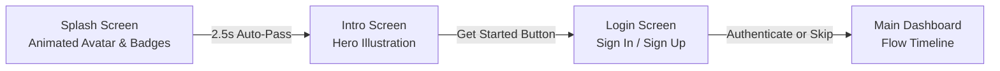
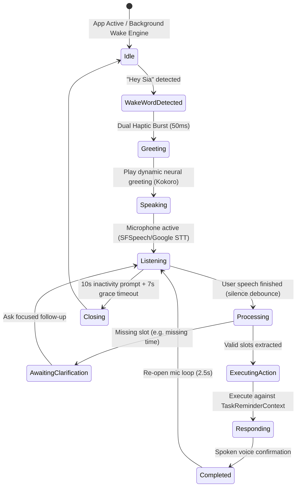

# 👑 Regius — Product Requirements Document (PRD)

> **Document Status**: Active / Single Source of Truth for Product Requirements  
> **Target Audience**: Product Managers, Software Engineers, AI Agents (Antigravity), QA  
> **Related Documents**: [DESIGN_SYSTEM.md](DESIGN_SYSTEM.md) | [ARCHITECTURE.md](ARCHITECTURE.md) | [FEATURES.md](FEATURES.md) | [AGENTS.md](AGENTS.md)

---

## 1. Executive Summary & Product Vision

### 1.1 Product Overview

**Regius** is an artisanal, luxury productivity and mindful lifestyle mobile application built on React Native. Fusing high-grade stationery aesthetics ("Modern Warm Luxury") with a voice assistant named **Sia** (configurable as **Regius**, **Aria**, **Nova**, **Jarvis**, or **Echo**), Regius helps high-performing professionals, creators, and mindful knowledge workers organize their daily lives without the stress or sterile visual clutter of enterprise project-management tools.

### 1.2 The Core Philosophy

> _"Plan Your Day In Details — Calm, Tactile, Mindful."_

Most productivity apps fall into two extremes:

1. **Sterile corporate trackers** (Jira, Asana, ClickUp): Overwhelming, clinical, stress-inducing.
2. **Minimalist blank text editors** (Apple Notes, Things): Clean, but lacking proactive multimodal intelligence and tactile delight.

Regius bridges this divide:

- **Visual Warmth**: Cream linen canvases (`#FFFCE3`), organic asymmetric card geometry, 3D extruded tactile chips, and liquid spring animations.
- **Hands-Free Ambient Multimodal Interaction**: Always-on wake-word activation ("Hey Sia" / "Hey Regius"), Kokoro-82M neural TTS voice responses, and conversational command interpretation with slot clarification.
- **Mindful Balance**: Daily timeline blending deep-work blocks, hydration reminders, mindful breath resets, and habit streak tracking.

---

## 2. Target Audience & Personas

### Persona 1: The High-Performing Mindful Professional ("Alex", 32)

- **Role**: Staff Product Designer / Engineering Lead.
- **Pain Points**: Back-to-back video calls, context-switching fatigue, forgets hydration and posture resets, needs quick voice capture between meetings while walking or driving.
- **Goals**: Capture tasks and reminders hands-free, review daily flow at a glance, maintain a healthy routine.

### Persona 2: The Deep-Work Creative ("Elena", 27)

- **Role**: Independent Researcher / Author.
- **Pain Points**: Distracted by complicated project management tools; traditional dark-mode interfaces strain her eyes during daylight hours.
- **Goals**: Warm, soothing aesthetic interface that feels like physical paper, reliable recurring habit tracking with visual momentum.

---

## 3. Product Principles & Key Differentiators

1. **Artisanal Tactile Warmth Over Clinical Coldness**: Regius never defaults to sterile stark white (`#FFFFFF`) or cold grey canvases. The signature warm cream canvas (`#FFFCE3`) creates an immediate feeling of calm focus.
2. **True Conversational Dialogue Over Form Filling**: Instead of requiring users to fill multi-step dialogs, the voice assistant speaks, parses natural language, asks focused single-slot clarification questions when details are missing, and speaks friendly confirmations.
3. **Truthful Action Execution**: The voice assistant never hallucinates a completed action. It validates slots against strict parameters and only executes allowlisted operations against real application state.
4. **Local-First & Offline-Tolerant**: Core daily operations (viewing timeline, toggling tasks, checking habits, playing bundled voice greetings, adjusting settings) function entirely without network connectivity.
5. **No Visual Compromises**: Badges are strictly 3D upper layers; cards employ signature asymmetric corner radiuses; buttons follow strict full-pill geometry.

---

## 4. User Journeys & Functional Requirements

### 4.1 Onboarding & Authentication Journey

- **User Story**: As a new user, I experience a smooth, branded splash sequence, inspect the value proposition, and enter the app without friction.
- **Functional Requirements**:
  - `Splash.tsx`: Presents animated floating avatar, pulsing badges (`FloatHeart`, `FloatPicture`), brand title `Regius`, and enforces a 2.5-second minimum display timer before transitioning.
  - `Intro.tsx`: Displays high-resolution vector illustration (`IntroHeroIllustration.svg`), headline _"Plan Your Day In Details"_, and primary pill CTA navigating to `LoginScreen`.
  - `LoginScreen.tsx`: Tabbed Sign In / Sign Up with animated input borders, password visibility toggles, "Remember Me", terms checkbox, social buttons (Google, Apple), and a forgot-password sheet modal.
  - _Current Implementation Note_: Authentication currently operates via in-memory `AuthContext` (local state). Remote JWT backend authentication is **Planned** (see [FEATURES.md](FEATURES.md)).

---

### 4.2 Daily Dashboard & Briefing Journey

- **User Story**: As an active user opening the app in the morning, I want to see my daily readiness, balance breakdown, and chronological timeline structured in the standard sequence.
- **Functional Requirements**:
  - **Universal Product Sequence Standard**: All navigation, balance grids, filters, and briefings strictly follow **1. Tasks** → **2. Reminders** → **3. Habits**.
  - **Daily Briefing Card**: Displays current greeting (e.g., "Good morning, Alex"), date banner, quick metrics (`taskCount` → `reminderCount` → `habitCount`), and playable Kokoro-powered spoken briefing audio.
  - **Daily Balance Grid**: 3-card bento grid tracking **Tasks** (Yellow `#FFFCEB`), **Reminders** (Green `#EDFDF5`), and **Habits** (Purple `#EFF2FE`) with completion percentages and one-tap deep navigation.
  - **Today's Flow Timeline**: Chronological cards representing the day's schedule (`TimelineItemCard.tsx`), enclosed in a unified luxury container box (`backgroundColor: '#FFFFFF'`, `borderRadius: 24`, `borderWidth: 1.5`, `borderColor: '#ECE8DF'`), filterable by _All Flow_, _Tasks_, _Reminders_, and _Habits_.
    - **Simplified Header**: "Today’s Flow" • "Your day at a glance".
    - **Signature Inverted Scooped Corner Cutout**: The top-right corner features an organic concave cutout (`CW: 44, CH: 44`) with smooth bezier fillets, rendered via SVG.
    - **Category Color Matching**: Tasks follow yellow (`#FFFCEB`), Reminders follow green (`#EDFDF5`), Habits follow purple (`#EFF2FE`).
    - **Outside Floating Round Checkbox**: A circular checkbox (`26x26`, `borderRadius: 13`) floats elevated in the carved-out negative space outside the card, with the container surface showing through the cutout.
    - **Persistent Left Category Icon**: The timeline node on the left always retains the category icon and is never replaced by a check.
  - **Dynamic Scroll-Reactive Layer Header**:
    - **Unscrolled**: Renders flush with the canvas `#FBF9F3` with dark wordmark (`#1B1C19`) and `dark-content` status bar.
    - **Scrolled (`scrollY > 15px`)**: Seamlessly elevates into a floating brand layer with primary `LavenderPurple` (`#8383D6`) background, dynamic `14px` bottom padding cushion, rounded bottom corners (`24px`), deep purple drop shadow (`#4A3E8A`), `light-content` status bar, unique crown-crested `<RegiusLogo variant="light" />` with radiant star sparkle, and elevated circular white action buttons preserving their icon colors.
  - **Hands-Free Activation**: Long-press on the center floating plus button or vocal wake phrase instantly activates the assistant.

---

### 4.3 Voice Assistant & Conversational Productivity Journey

- **User Story**: As a user with occupied hands, I want to say _"Hey Sia, add a task to review the quarterly budget at 3 PM"_ and have it confirmed verbally without touching the screen.
- **Functional Requirements**:
  - **Configurable Wake Phrase**: Supports 6 official presets:
    1. `Hey Sia` (**Default**)
    2. `Hey Regius`
    3. `Hey Aria`
    4. `Hello Nova`
    5. `Hey Jarvis`
    6. `Hey Echo`
  - **Phonetic STT Tuning**: Extensive alias regexes absorb common acoustic misrecognitions (e.g., "see ya", "cera", "raygeus", "radius").
  - **Dual Haptic Feedback**: Immediate physical acknowledgment on wake detection (iOS: 50ms vibration; Android: patterned vibration `[0, 50, 40, 70]`).
  - **Dynamic Natural Greetings**: Greetings synthesized via Kokoro-82M neural voices or pre-warmed instant cache; fallback to bundled WAV assets.
  - **Conversational Slot Filling**:
    - If user says _"Add a task"_, assistant asks: _"What is the title of the task?"_
    - If user says _"Set a reminder to call Mom"_, assistant asks: _"What time would you like to be reminded?"_
  - **Truthful Execution**:
    - Direct CRUD integration with `TaskReminderContext`.
    - Supported intents: `ADD_TASK`, `COMPLETE_TASK`, `SHOW_TASKS`, `ADD_REMINDER`, `SHOW_REMINDERS`, `ADD_HABIT`, `LOG_HABIT`, `SHOW_HABITS`, `START_FOCUS`, `EXTEND_FOCUS`, `PLAY_BRIEF`, `SCHEDULE_SPRINT`, `RESHUFFLE`, `CANCEL`, `GOODBYE`.
  - **Siri-like Inactivity Lifecycle**:
    - 10 seconds of silence in listening state triggers verbal prompt: _"Are you still there?"_
    - 7 additional seconds of silence gracefully closes the assistant sheet.

---

### 4.4 Task, Reminder, and Habit Management

- **Task Management**:
  - Filter by category: Works (`#FFFCEB`), Sport (`#EDFDF5`), Habits (`#EFF2FE`), Events (`#FFF3E0`).
  - Toggle done state with tactile custom checkbox (`24x24`, `#EFF1F4` unchecked, `#E8FDF0` checked with `#52D22E` checkmark).
  - Add task via modal or full screen with priority (`low`, `medium`, `high`), due date, due time, and subtasks.
- **Reminder Management**:
  - Upcoming vs. Completed tabs.
  - Time, date, recurrence (`Once`, `Daily`, `Every 2 hrs`), sound, and urgent alarm flags.
  - Spoken preview of reminders via TTS.
- **Habit Tracking**:
  - Time of day categories: Morning, Mindful, Evening.
  - Current streak tracking with auto-increment on completion and auto-decrement on unchecking.
  - Daily progress ring and celebration toasts.

---

### 4.5 Settings, Voice Studio & Personalization

- **Profile Management**: Name, email, role, bio editing.
- **Voice Studio**: Selection between 7 Kokoro neural voices:
  - _Bella_ (`af_bella`, Female, American, Gentle & Clear) — **Default**
  - _Nicole_ (`af_nicole`, Female, American, Crisp & Natural)
  - _Adam_ (`am_adam`, Male, American, Deep & Authoritative)
  - _Michael_ (`am_michael`, Male, American, Confident & Smooth)
  - _Emma_ (`bf_emma`, Female, British, Serene & Articulate)
  - _George_ (`bm_george`, Male, British, Classic & Distinguished)
  - _Heart_ (`af_heart`, Female, American, Warm & Empathetic)
- **Speech Speed Control**: 0.75x to 1.5x slider.
- **Auto-Speak Toggle**: Option to toggle audio speech playback for text replies.
- **Wake Word Configuration**: Enable/disable wake word detection, switch active preset phrase, test phonetic recognition.
- **Storage & Cache**: View cached audio size, clear audio cache, reset settings to defaults.

---

## 5. Feature Prioritization Matrix

| Priority | Feature Area                                   | Description                                                                                                       | Implementation Status                                    |
| :------- | :--------------------------------------------- | :---------------------------------------------------------------------------------------------------------------- | :------------------------------------------------------- |
| **P0**   | **Voice Assistant Core**                       | Wake word detection, state machine, STT listening, command interpretation, slot filling, task/reminder execution. | **Implemented**                                          |
| **P0**   | **Neural TTS & Audio**                         | Kokoro-82M cloud synthesis, audio caching, bundled fallback WAV playback, TrackPlayer integration.                | **Implemented**                                          |
| **P0**   | **Core UI & Theming**                          | Cream canvas, asymmetric cards, 3D badges, curved SVG tab bar, dark mode tokens.                                  | **Implemented**                                          |
| **P0**   | **Tasks & Reminders Context**                  | In-memory CRUD, category filtering, toggle completion, modal creators.                                            | **Implemented**                                          |
| **P0**   | **Voice Settings Persistence**                 | AsyncStorage storage for selected voice, speech speed, wake word phrase, and auto-speak flags.                    | **Implemented**                                          |
| **P1**   | **Offline Local Persistence for Tasks/Habits** | Hydrating `TaskReminderContext` state to/from `@react-native-async-storage/async-storage`.                        | **Partial** (Settings persisted, Tasks/Habits in-memory) |
| **P1**   | **OS-Level Scheduled Notifications**           | Native alarm/notification scheduling using local notification library.                                            | **Planned** (No notification lib installed yet)          |
| **P1**   | **On-Device ONNX Kokoro TTS**                  | Truly offline neural TTS using bundled `.onnx` model via `onnxruntime-react-native`.                              | **Partial** (JSI bridge patched, requires model bundle)  |
| **P2**   | **Remote Backend Cloud Sync**                  | User authentication, cloud sync for tasks/reminders/habits via REST API.                                          | **Planned** (`src/api` folders created as scaffolding)   |
| **P2**   | **Subscription & In-App Purchases**            | Premium plan gating (Unlimited AI Voice, Custom Wake Words, Cloud Backup).                                        | **Partial** (`PremiumContext` exists in mock state)      |

---

## 6. Offline vs. Online Capabilities

| Capability                          | Offline (Air-Gapped)                                                                | Online (Connected)                                            |
| :---------------------------------- | :---------------------------------------------------------------------------------- | :------------------------------------------------------------ |
| **Wake Word Detection**             | Works via on-device speech recognizer (`@react-native-voice/voice`)                 | Works via on-device speech recognizer                         |
| **Speech Recognition (STT)**        | Works if OS on-device dictation is available (iOS 15+, Android offline speech pack) | High accuracy cloud-assisted recognition                      |
| **Assistant Speech Playback**       | Instant playback using bundled WAV assets (`af_bella.wav`, etc.) & cached TTS audio | Full neural synthesis via Kokoro-82M Gradio SSE queue (24kHz) |
| **Task / Reminder / Habit CRUD**    | Fully functional in-memory                                                          | Fully functional in-memory (and cloud sync when implemented)  |
| **Voice Selection & Customization** | Preview bundled voice samples, adjust speed, switch wake word                       | Full synthesis test lines in Voice Studio                     |
| **Dark / Light Theme Toggling**     | Fully functional                                                                    | Fully functional                                              |

---

## 7. Performance, Reliability & Usability Requirements

1. **Wake-Word Activation Latency**: Under 250ms from user finishing the wake phrase to initial haptic vibration.
2. **Greeting Playback Latency**: Under 300ms for pre-warmed / cached greetings; guaranteed fallback to bundled WAV within 1800ms if network is slow.
3. **Audio Session Hygiene**: Never record microphone audio while Kokoro or TrackPlayer is playing spoken audio (prevents acoustic feedback loops). Always release audio session cleanly with a 160ms–300ms yield gap.
4. **Fluid Frame Rates**: 60fps animations for Lottie holographic orb, curved tab bar springs, plus button rotation, and modal slide-ups.
5. **Reduced Motion Accessibility**: Respect `AccessibilityInfo.isReduceMotionEnabled` across orb breathing, floating badge loops, and screen transitions.

---

## 8. Unresolved Product Decisions & Future Roadmap

1. **Local Notification Architecture**: Decide between `@notifee/react-native` and `expo-notifications` for scheduling OS-level reminder alarms and urgent banners.
2. **On-Device ONNX Packaging**: Determine whether to bundle the 82M Kokoro ONNX model weights in the app binary (~85MB) or download it on first launch via a dedicated Voice Pack manager.
3. **Cloud Backend Architecture**: Finalize API specs (REST vs. GraphQL / Supabase) for user authentication and cross-device sync.
