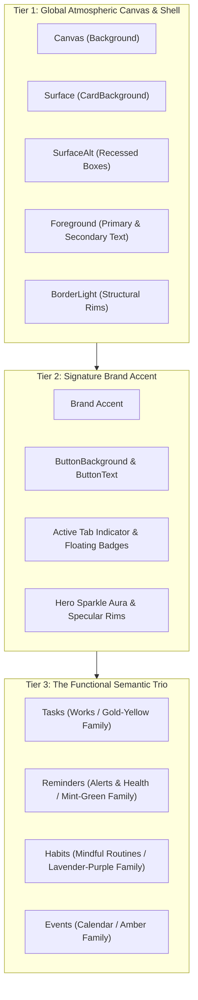
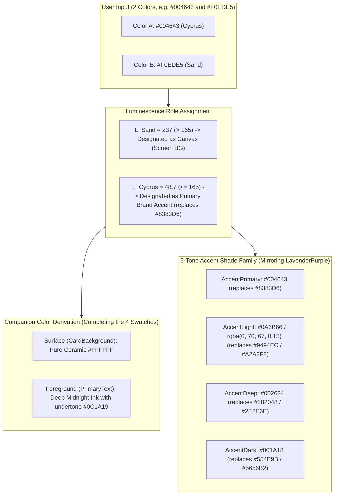
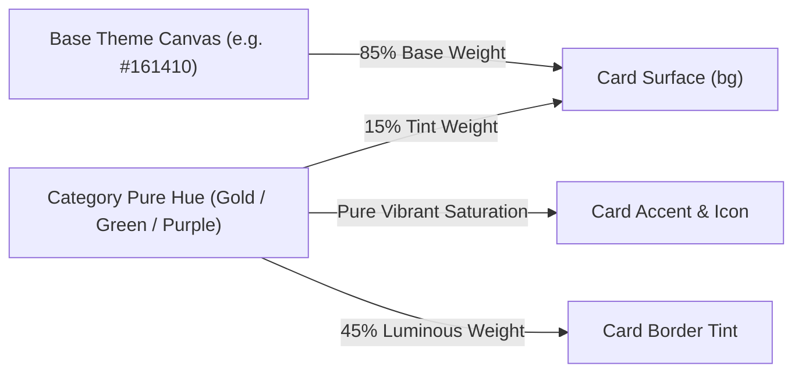

# Regius — Theme Creation Rules & Harmonic Color Architecture

**Applies to:** Regius Theme Engine (`src/Theme/ThemeContext.tsx`, `src/Theme/useAppTheme.ts`)  
**Design Authority:** `DESIGN_SYSTEM.md` (§2.3 Category Trios, §2.5 Prestige Themes), `AGENTS.md`  
**Purpose:** Comprehensive guide, formulas, rules, and intelligent generator specifications for creating luxury-grade, harmonious themes in Regius from user-supplied color palettes.

---

## 1. Executive Philosophy: The Three-Tier Color Anatomy

In Regius, a theme is **not just 4 flat colors**. Regius is a mindful luxury productivity app that relies on visual hierarchy, emotional warmth, and instantaneous cognitive recognition.

Every theme is architected into **three distinct, interlocked color tiers**:



1. **Tier 1 — Atmospheric Canvas & Shell (6 Tokens):** Governs the background canvas, elevated bento cards, recessed input wells, divider lines, and high-emphasis typography.
2. **Tier 2 — Signature Brand Accent (4 Tokens):** The theme’s primary luxury personality (e.g. Lavender Purple in Warm Cream, Imperial Gold in Obsidian Night, Cyprus Teal / Coastal Sand in Cyprus Sand). Powers primary CTAs, active indicators, and hero sparkles.
3. **Tier 3 — The Functional Semantic Trio (24 Tokens across 4 Categories):** The permanent cognitive anchors for the user’s productivity flow:
   - **Tasks:** **Yellow / Gold** (Energy, Execution, Priority)
   - **Reminders:** **Mint / Fresh Green** (Vitality, Health, Timely Nudges)
   - **Habits:** **Lavender / Purple** (Mindfulness, Routines, Long-Term Mastery)
   - **Events / Alerts:** **Amber / Coral** (Time gates, Deadlines)

> [!IMPORTANT] > **The Golden Law of Regius Semantics:**  
> A theme must **NEVER** change the fundamental hue identity of the functional trio (e.g., turning Tasks into blue, or Reminders into yellow). Doing so destroys cognitive muscle memory. Instead, the theme **harmonically adapts the tints, borders, and ambient glow** of the trio to match the canvas luminescence and undertone temperature.

---

## 2. Deconstruction of Benchmark Themes

To understand how colors interact, examine how the two benchmark themes (Warm Cream and Obsidian Night) structure their tokens:

### 2.1 Benchmark 1: Warm Cream (`classic_light`) — Light Aesthetic

| Tier       | Role           | Token Name         | Hex Code  | Visual Experience                              |
| :--------- | :------------- | :----------------- | :-------- | :--------------------------------------------- |
| **Tier 1** | Canvas         | `Background`       | `#FFFCE3` | Warm, unbleached luxury stationery parchment   |
|            | Surface        | `CardBackground`   | `#FFFFFF` | Crisp ceramic white elevated card              |
|            | Recessed       | `SurfaceAlt`       | `#FAF8F5` | Subtly recessed input & sub-box wells          |
|            | Structural Rim | `BorderLight`      | `#E8E2D5` | Soft ivory-sand hairline divider               |
|            | Primary Text   | `PrimaryText`      | `#000000` | Deep midnight ink with 100% legibility         |
|            | Secondary Text | `SecondaryText`    | `#666665` | Muted slate steel for subtitles and timestamps |
| **Tier 2** | Brand Accent   | `Accent`           | `#8383D6` | Royal Lavender Purple (Signature brand hue)    |
|            | Primary Button | `ButtonBackground` | `#242424` | Nero black full-pill with pure white text      |
|            | Button Text    | `ButtonText`       | `#FFFFFF` | Crisp white on dark button                     |

#### Warm Cream — Semantic Category Facets

Every item card requires all **6 category facets**: `bg`, `border`, `accent`, `text`, `iconBg`, `shadow`:

| Domain                   | Facet 1: `bg`         | Facet 2: `border` | Facet 3: `accent` | Facet 4: `text` | Facet 5: `iconBg` | Facet 6: `shadow` |
| :----------------------- | :-------------------- | :---------------- | :---------------- | :-------------- | :---------------- | :---------------- |
| **1. Tasks** (Gold)      | `#FFFDF7` / `#FFFCEB` | `#FFF5B8`         | `#F5C518`         | `#B48216`       | `#FFFCEB`         | `#F5C518`         |
| **2. Reminders** (Green) | `#F5FDF9` / `#EDFDF5` | `#C6FFDD`         | `#1B9A72`         | `#1B9A72`       | `#EDFDF5`         | `#52D22E`         |
| **3. Habits** (Purple)   | `#F7F8FE` / `#EFF2FE` | `#D8DBFF`         | `#8383D6`         | `#7059C8`       | `#EFF2FE`         | `#8383D6`         |
| **4. Events** (Amber)    | `#FFF9F0` / `#FFF0DE` | `#FFE0B2`         | `#FF9800`         | `#E65100`       | `#FFF3E0`         | `#FF9800`         |

---

### 2.2 Benchmark 2: Obsidian Night (`classic_dark`) — Dark Aesthetic

| Tier       | Role           | Token Name         | Hex Code  | Visual Experience                   |
| :--------- | :------------- | :----------------- | :-------- | :---------------------------------- |
| **Tier 1** | Canvas         | `Background`       | `#121417` | Deep obsidian noir, zero eye strain |
|            | Surface        | `CardBackground`   | `#1E2228` | Charcoal slate elevated card        |
|            | Recessed       | `SurfaceAlt`       | `#171A1F` | Deep graphite well                  |
|            | Structural Rim | `BorderLight`      | `#2C3035` | Slate grey border rim               |
|            | Primary Text   | `PrimaryText`      | `#FFFFFF` | Luminous pure white header          |
|            | Secondary Text | `SecondaryText`    | `#A3A8B1` | Cool silver grey metadata           |
| **Tier 2** | Brand Accent   | `Accent`           | `#F5C518` | Imperial Gold luster                |
|            | Primary Button | `ButtonBackground` | `#FFFFFF` | Luminous white button               |
|            | Button Text    | `ButtonText`       | `#000000` | Jet black text on button            |

#### Obsidian Night — Deep Jewel Category Facets

In dark mode, category cards switch from light pastels to **deep jewel-toned chambers** with glowing luminous rims:

| Domain                   | Facet 1: `bg`                  | Facet 2: `border` | Facet 3: `accent` | Facet 4: `text` | Facet 5: `iconBg` | Facet 6: `shadow` |
| :----------------------- | :----------------------------- | :---------------- | :---------------- | :-------------- | :---------------- | :---------------- |
| **1. Tasks** (Gold)      | `#2A2416` (Deep amber noir)    | `#DEAA14`         | `#F5C518`         | `#FFFFFF`       | `#38301D`         | `#F5C518`         |
| **2. Reminders** (Green) | `#162820` (Deep emerald noir)  | `#1B9A72`         | `#52D22E`         | `#FFFFFF`       | `#1F382D`         | `#52D22E`         |
| **3. Habits** (Purple)   | `#202336` (Deep sapphire noir) | `#8383D6`         | `#8383D6`         | `#FFFFFF`       | `#2C304A`         | `#8383D6`         |
| **4. Events** (Amber)    | `#331F18` (Deep burnt amber)   | `#FF9800`         | `#FF9800`         | `#FFFFFF`       | `#452A20`         | `#FF9800`         |

---

### 2.3 Benchmark 3: Cyprus Sand (`cyprus_sand`) — Coastal Architectural Aesthetic

Cyprus Sand demonstrates how a bespoke luxury theme creates serene warmth and architectural precision from two user-provided colors: **CYPRUS (`#004643`)** as the primary brand accent (replacing LavenderPurple `#8383D6`) and **SAND (`#F0EDE5`)** as the light screen background canvas ($L = 237$).

- **Canvas (`Background`):** `#F0EDE5` (Warm unbleached luxury coastal sand stationery)
- **Surface (`CardBackground`):** `#FFFFFF` (Crisp ceramic white elevated bento cards)
- **Primary Brand Accent (`Accent`):** `#004643` (Deep architectural cyprus pine teal)
- **Primary Text (`Foreground`):** `#0C1A19` (Deep cyprus midnight ink, 12.5:1 AAA contrast against cards)
- **Secondary Text:** `#586B69` (Muted sage slate for subtitles and metadata)
- **SurfaceAlt (Recessed wells):** `#EAE5DB` (Recessed sand well, 2% luminance drop)
- **BorderLight (Structural rims):** `#DDD7CB` (Ivory-sand hairline boundary)
- **ButtonBackground:** `#004643` (Cyprus full-pill anchor)
- **ButtonText:** `#F0EDE5` (Luminous sand typography on button)
- **AccentDeep (Scrolled header & action bars):** `#002624` (Deep cyprus noir)
- **AccentLight (Auras & highlights):** `#0A6B66` / `rgba(0, 70, 67, 0.15)`
- **AccentDark (Dock & gradient base):** `#001A18`

---

## 3. Intelligent Derivation Rules: Creating Themes from Core Colors

The theme engine operates on an intelligent derivation hierarchy. Whether you provide **2 colors** (Minimalist), **4 colors** (Standard), or a **full precision spec**, the engine guarantees chromatic harmony, accessibility contrast, and visual consistency with the app's master benchmark: **Warm Cream (`classic_light`)**.

---

### 3.1 The Two-Color Autonomous Expansion Engine (Warm Cream Baseline)

When a user supplies **ONLY TWO COLORS**:

The theme engine first applies the **Luminescence Role Assignment Rule**:

1. Calculate Relative Perceived Luminance for both colors: $L_1$ and $L_2$.
2. The color with the higher luminance ($L > 165$) is designated as **`Canvas (Background)`** — the atmospheric screen canvas.
3. The deeper/richer color is designated as **`Brand Accent`** — the signature luxury personality that **directly takes the place of `LavenderPurple` (`#8383D6`) and all its functional roles**.



#### Step-by-Step Derivation Logic from Warm Cream:

1. **Canvas Luminescence Check:**  
   Calculate $L = 0.299 \times R + 0.587 \times G + 0.114 \times B$.

2. **Branch A: If Canvas is Light ($L > 165$) — Direct Warm Cream Harmonic Mirror:**

   - **`Background`:** Locked to the lighter input color (e.g. `#F0EDE5` Sand).
   - **`CardBackground`:** Locked to pure ceramic white `#FFFFFF` (exact Warm Cream standard, preserving clean elevation against the tinted canvas).
   - **`PrimaryText`:** Deep midnight ink tinted with the brand accent's undertone (e.g. `#0C1A19` for Cyprus, guaranteeing 12.5:1+ readability).
   - **`SecondaryText`:** Muted slate tinted with the brand undertone (e.g. `#586B69`).
   - **`SurfaceAlt`:** Derived by shifting `Canvas` brightness down by 2% (e.g. `#EAE5DB`).
   - **`BorderLight`:** Derived by shifting `Canvas` lightness down by 10% (e.g. Ivory sand `#DDD7CB`).
   - **`ButtonBackground`:** Assigned to the Primary Brand Accent (e.g. `#004643`).
   - **`ButtonText`:** The lighter Canvas color (e.g. `#F0EDE5`) or Pure `#FFFFFF`.
   - **`Accent`:** Assigned to the Primary Brand Accent (e.g. `#004643`), replacing `LavenderPurple` across all badges, sparkles, and active indicators.
   - **Category Item Cards (Tasks, Reminders, Habits):**
     Directly inherit Warm Cream's cognitive pastel trio:
     - **Tasks (Gold):** `bg: #FFFDF7` / `#FFFCEB`, `border: #FFF5B8`, `accent: #F5C518`, `text: #B48216`.
     - **Reminders (Green):** `bg: #F5FDF9` / `#EDFDF5`, `border: #C6FFDD`, `accent: #1B9A72`, `text: #1B9A72`.
     - **Habits (Purple):** `bg: #F7F8FE` / `#EFF2FE`, `border: #D8DBFF`, `accent: #8383D6`, `text: #7059C8`.

3. **Branch B: If Canvas is Dark ($L \le 165$) — Dark Inversion of Warm Cream:**

   - **`Background`:** The dark canvas color (e.g. `#121417` Obsidian).
   - **`CardBackground`:** Canvas elevated by +6% brightness & +2% saturation (e.g. `#1E2228` charcoal slate).
   - **`PrimaryText`:** Luminous white `#FFFFFF` or warm ivory.
   - **`SecondaryText`:** Soft slate silver `#A3A8B1`.
   - **`SurfaceAlt`:** Canvas + 3% brightness (`#171A1F`).
   - **`BorderLight`:** Canvas + 15% lightness (`#2C3035`).
   - **`ButtonBackground`:** Brand Accent or Pure `#FFFFFF`.
   - **`ButtonText`:** Dynamically computed: if `isLightColor(ButtonBackground)` then `#000000` else `#FFFFFF`.
   - **`Category Item Cards:`** Deep jewel-toned chambers adapted to dark canvas (Rule 3).

4. **The 4-Quadrant Swatch Disc Output:**
   In [`AppearanceSection.tsx`](file:///Users/renishbhuva/Documents/Development/React_Native/Regius/src/Screens/Settings/Components/AppearanceSection.tsx) and [`ThemePresetCard.tsx`](file:///Users/renishbhuva/Documents/Development/React_Native/Regius/src/Screens/Theme/Components/ThemePresetCard.tsx):
   - **Quadrant 1 (Top-Left):** `Canvas` (Screen BG, e.g. `#F0EDE5` Sand)
   - **Quadrant 2 (Top-Right):** `CardBackground` (Elevated Surface, e.g. `#FFFFFF` Pure White)
   - **Quadrant 3 (Bottom-Left):** `Accent` (Primary Brand Accent, e.g. `#004643` Cyprus)
   - **Quadrant 4 (Bottom-Right):** `PrimaryText` (Foreground Ink, e.g. `#0C1A19` Cyprus Noir)

---

### 3.2 The Accent Shade Family System (Replacing LavenderPurple)

In Regius, `LavenderPurple` (`#8383D6`) is **not an isolated single token**; it anchors a full 5-tone operational shade network across navigators, headers, buttons, audio widgets, and auras.

When creating a new theme, the engine generates the corresponding **Harmonic Shade Family** for the new primary accent:

| Shade Role                              | LavenderPurple Benchmark    | Cyprus Sand Companion   | Functional Application in App                                                             |
| :-------------------------------------- | :-------------------------- | :---------------------- | :---------------------------------------------------------------------------------------- |
| **1. AccentPrimary ($A_0$)**            | `#8383D6`                   | `#004643`               | Main CTA pills, brand badges, active tab icons, daily brief play button                   |
| **2. AccentLight ($A_{\text{light}}$)** | `#9494EC`, `#A2A2F8`        | `#0A6B66` / `#0D7E78`   | Upper gradient stops in bottom tab bar, floating Plus button gradient, active focus halos |
| **3. AccentAura ($A_{\text{aura}}$)**   | `rgba(131, 131, 214, 0.25)` | `rgba(0, 70, 67, 0.15)` | Glowing radial background auras, card shadows, tactile button halos                       |
| **4. AccentDeep ($A_{\text{deep}}$)**   | `#282048`, `#14151C`        | `#002624`               | Scrolled reactive sticky headers, modal bottom action bars, inner dock well               |
| **5. AccentDark ($A_{\text{dark}}$)**   | `#554E9B`, `#5656B2`        | `#001A18` / `#00312F`   | Bottom gradient stops in tab bar and plus button, deep shadow borders                     |

---

### Rule 1: Canvas Luminescence & Ambient Detection

Compute the Perceived Relative Luminance (\(L\)) of the canvas color:

$$L = 0.299 \times R + 0.587 \times G + 0.114 \times B$$

- **If \(L > 165\):** Theme is classified as **Light Mode**.
  - `isDarkMode = false`
  - High-contrast text: Dark tones (\(L < 40\)).
  - Category surfaces: Delicate pastel washes (opacity ~6–10% tint over white).
  - Category borders: Medium pastel saturation.
- **If \(L \le 165\):** Theme is classified as **Dark Mode**.
  - `isDarkMode = true`
  - High-contrast text: Luminous cream/white tones (\(L > 200\)).
  - Category surfaces: Deep jewel-toned black chambers (opacity ~12–18% hue over canvas).
  - Category borders: Vibrant luminous outlines (border width: 1px or 1.5px).

---

### Rule 2: Shell Contrast Derivation (Surface, SurfaceAlt, Border)

| Token Name           | For Light Canvas (\(C\_{\text{canvas}}\))         | For Dark Canvas (\(C\_{\text{canvas}}\))              |
| :------------------- | :------------------------------------------------ | :---------------------------------------------------- |
| **`CardBackground`** | Pure `#FFFFFF` or canvas shifted +4% brightness   | Canvas shifted +6% brightness & +2% saturation        |
| **`SurfaceAlt`**     | Canvas blended with 4% grey/cool tone (`#FAF8F5`) | Canvas shifted +3% brightness (`#171A1F`)             |
| **`BorderLight`**    | Canvas shifted -12% lightness (`#E8E2D5`)         | Canvas shifted +15% lightness (`#2C3035` / `#332E24`) |
| **`SecondaryText`**  | PrimaryText at 60% alpha or muted warm grey       | PrimaryText at 65% alpha or soft slate `#A3A8B1`      |

---

### Rule 3: The Semantic Category Adaptation Matrix

To generate the item cards for **Tasks**, **Reminders**, and **Habits**, the engine applies a **Chrominance Blend**:



#### Mathematical Formulas for Category Card Tints:

1. **Light Mode Category Surface (`bg`):**

   - Blend 94% White (`#FFFFFF`) + 6% Category Hue.
   - Example (Tasks): `#FFFDF7` or `#FFFCEB`.
   - Example (Reminders): `#F5FDF9` or `#EDFDF5`.
   - Example (Habits): `#F7F8FE` or `#EFF2FE`.

2. **Light Mode Category Border (`border`):**

   - Blend 80% White + 20% Category Hue.
   - Example (Tasks): `#FFF5B8`.
   - Example (Reminders): `#C6FFDD`.
   - Example (Habits): `#D8DBFF`.

3. **Dark Mode Category Surface (`bg`):**

   - Blend 82% Canvas + 18% Category Jewel Hue.
   - Example (Tasks): `#2A2416` (warm amber-infused noir).
   - Example (Reminders): `#162820` (emerald-infused noir).
   - Example (Habits): `#202336` (lavender-sapphire noir).

4. **Dark Mode Category Border (`border`):**
   - Category Hue at 50% luminance. Must have high contrast against `bg`.
   - Example (Tasks): `#DEAA14`.
   - Example (Reminders): `#1B9A72`.
   - Example (Habits): `#8383D6`.

---

### Rule 4: Action Buttons & Haptic Contrasts

Primary full-pill buttons (`CustomButton`) must guarantee instantaneous accessibility:

- **Button Fill (`ButtonBackground`):**
  - If Light Theme: Dark contrast button (`#242424` or theme's deepest accent) so it anchors the screen.
  - If Dark Theme: Luminous fill (Theme `Accent` or Pure `#FFFFFF`).
- **Button Text (`ButtonText`):**
  - Must evaluate `isLightColor(ButtonBackground)`. If true, text is `#000000`; if false, text is `#FFFFFF`.

---

## 4. Theme Input Templates

When you give colors to the assistant to create a theme, select one of the three templates below:

### Option A: Ultra-Minimal 2-Color Input (Warm Cream Baseline — Recommended)

Supply only the Canvas and your Brand Accent. The engine autonomously derives the remaining 28 tokens and category cards using the **Warm Cream** baseline:

```text
Theme Name: <Display Name, e.g. Royal Amethyst>
ID: <slug_id, e.g. royal_amethyst>
Tagline: <Luxury descriptive tagline>
Tier: <1 (default) or 2, 3, 4, 5>

1. Canvas (Background): #______
2. Accent (Brand Highlight): #______
```

---

### Option B: Standard 4-Core Color Input (Engine Auto-Derives All 25 Secondary Tokens)

Provide the 4 quadrant disc colors, and the engine will extrapolate all secondary tokens and category cards:

```text
Theme Name: <Display Name, e.g. Royal Amethyst>
ID: <slug_id, e.g. royal_amethyst>
Tagline: <Luxury descriptive tagline>
Tier: <1 (default) or 2, 3, 4, 5>

1. Canvas (Background): #______
2. Surface (CardBackground): #______
3. Accent (Signature Brand Highlight): #______
4. Foreground (PrimaryText): #______
```

---

### Option C: Master Precision Input (Full Custom Handcrafted Control)

Use this when you want handcrafted control over every single card type, button, and surface:

```text
Theme Name: <Display Name>
ID: <slug_id>
Tagline: <Tagline>
Tier: <1 to 5>

--- Global Shell ---
Canvas (Background): #______
Surface (CardBackground): #______
SurfaceAlt (Recessed wells): #______
BorderLight (Dividers & rims): #______
PrimaryText (Headings): #______
SecondaryText (Subtitles): #______

--- Brand Accent ---
Accent (Brand highlight): #______
ButtonBackground: #______
ButtonText: #______
BottomBarTint: #______

--- 1. Tasks Card (Gold / Amber Family) ---
Tasks_Bg: #______
Tasks_Border: #______
Tasks_Accent: #______
Tasks_Text: #______

--- 2. Reminders Card (Green / Mint Family) ---
Reminders_Bg: #______
Reminders_Border: #______
Reminders_Accent: #______
Reminders_Text: #______

--- 3. Habits Card (Purple / Lavender Family) ---
Habits_Bg: #______
Habits_Border: #______
Habits_Accent: #______
Habits_Text: #______
```

---

## 5. Code Integration Architecture

When a new theme is finalized, it is wired into the codebase through 4 exact files:

```text
src/
├── Theme/
│   ├── ThemeContext.tsx      # 1. Register ID, color dictionary, THEME_PRESETS_DATA
│   └── useAppTheme.ts        # 2. Expose getCategoryTheme() overrides if theme-specific
├── Services/
│   └── MilestoneService.ts   # 3. Register theme in MILESTONE_TIERS unlock level
└── Components/
    └── AddModal/
        └── ModalBottomBar.tsx # 4. Register custom bottom action bar tint
```

### TypeScript Definition Helpers (`src/Theme/ThemeContext.tsx`)

#### From 2 Colors (Warm Cream Baseline):

```ts
export const royalAmethystColors = createThemePaletteFromTwoColors(
  '#14101A', // Canvas
  '#9B51E0', // Brand Accent
  {
    // Optional manual fine-tunings
  },
);
```

#### From 4 Primary Colors:

```ts
export const royalAmethystColors = createThemePalette(
  '#14101A', // Canvas
  '#1E1826', // Surface
  '#9B51E0', // Brand Accent
  '#F5EDFC', // Primary Text
  {
    // Optional manual fine-tunings
    SecondaryText: '#AA9EBA',
    SurfaceAlt: '#181320',
    BorderLight: '#32283F',
  },
);
```

---

## 6. Verification Checklist for Any New Theme

Before approving any newly integrated theme, run this quality checklist:

1. [ ] **4-Quadrant Disc Swatch:** In [`AppearanceSection.tsx`](file:///Users/renishbhuva/Documents/Development/React_Native/Regius/src/Screens/Settings/Components/AppearanceSection.tsx), verify that the 4-color round disc correctly displays `Canvas`, `Surface`, `Accent`, and `Foreground`.
2. [ ] **Luminescence Contrast:** Verify that headers and primary text have at least 4.5:1 contrast against `Canvas` and `Surface`.
3. [ ] **Category Separation:** Verify that Task cards feel golden, Reminder cards feel mint-green, and Habit cards feel lavender-purple against the new background.
4. [ ] **Floating Tab Bar Notch:** Verify that the floating bottom tab bar's center notch blends seamlessly with the theme's canvas.
5. [ ] **TypeScript Check:** Run `npx tsc --noEmit` and confirm 0 compiler errors.

---

## 7. Screen-by-Screen Theme Application Rules (Universal Engine Specification)

To prevent fragmented styling and hardcoded color leaks when switching themes, **every screen and visual component must obey these strict binding rules**:

### Rule S1: Screen Root & Container Canvas

- **Rule:** Every screen's outermost container `<View style={[styles.container, { backgroundColor: bgMain }]}>` **MUST** bind directly to `themeColors.Background` (or `useAppTheme().bgMain`).
- **Violation:** Never hardcode `backgroundColor: Colors.CreamBackground` or `isDarkMode ? '#121417' : Colors.CreamBackground` in screen files.
- **Applies to:** `DashboardScreen`, `TasksScreen`, `RemindersScreen`, `HabitsScreen`, `SettingsScreen`, `ProfileScreen`, `SubscriptionScreen`, `TaskDetailsScreen`, `ReminderDetailsScreen`, `HabitDetailsScreen`, `Intro.tsx`, `LoginScreen.tsx`.

### Rule S2: Section Sheets & Background SVGs

- **Rule:** Background SVGs for scrollable sections (`FlowSectionBackgroundSvg`, `TaskSectionBackgroundSvg`, `ReminderSectionBackgroundSvg`, `HabitSectionBackgroundSvg`) **MUST NOT** render hardcoded `#FFFDF7` cream gradients.
  - In **Light Mode** ($L > 165$): Section sheets must use a subtle shift of the theme canvas (e.g. for Sand `#F0EDE5`, the stops transition through `#FAF8F3` -> `#F0EDE5` -> `#E8E4DA`).
  - In **Dark Mode** ($L \le 165$): Section sheets must use `themeColors.SurfaceAlt` (or `#171A1F`), ensuring dark cards never sit on an ivory/cream paper background.
- **Applies to:** `FlowSectionSheet.tsx`, `FlowSectionBackgroundSvg.tsx`, `TaskSectionBackgroundSvg.tsx`, `ReminderSectionBackgroundSvg.tsx`, `HabitSectionBackgroundSvg.tsx`.

### Rule S3: Scroll-Reactive Sticky Headers

- **Rule:** When the user scrolls, the header background interpolation `headerBgColor` **MUST** interpolate towards `themeColors.AccentDeep` (`#002624` for Cyprus Sand, `#282048` for Warm Cream, `#08080A` for Obsidian Night) or `themeColors.CardBackground`.
- **Violation:** Never hardcode `outputRange: [..., isDarkMode ? '#282048' : Colors.LavenderPurple]`.
- **Applies to:** `ScreenHeader.tsx`, `SubScreenHeader.tsx`, `DashboardHeader.tsx`, `DashboardScreen.tsx`, `TasksScreen.tsx`, `RemindersScreen.tsx`, `HabitsScreen.tsx`, `SettingsHeader.tsx`, `MilestoneFullScreenSheet.tsx`.

### Rule S4: Floating Bottom Tab Bar & Dock

- **Rule:** The floating dock and center Plus button **MUST** inherit the active theme’s primary accent family:
  - **Bar Gradient (`BottomTabPatternSvg`):** Top stop is `themeColors.AccentLight` (or `#0A6B66`), middle stop is `themeColors.Accent` (`#004643`), and bottom stop is `themeColors.AccentDark` (`#001A18`).
  - **Floating Plus Button (`PlusButtonPatternSvg`):** Derived from `themeColors.AccentLight` -> `themeColors.Accent` -> `themeColors.AccentDeep`.
  - **Dock Notch Perimeter & Halo:** `strokeColor` must bind to `themeColors.Background` (so the center curve cutout blends into the screen background without an outline seam).
  - **Active Tab Indicator (`FocusedTabPatternSvg`):** Radial glow must bind to `themeColors.AccentAura` (not hardcoded purple `#8383D6`).

### Rule S5: Hero Bento Cards & Audio Briefing

- **Rule:** In `DailyBriefingCard.tsx`:
  - The circular Play/Pause button `playBtn` **MUST** use `themeColors.ButtonBackground` (or `themeColors.Accent` `#004643`) with `themeColors.ButtonText` (`#F0EDE5` / `#FFFFFF`).
  - The audio waveform icon and badge accents must use `themeColors.Accent`.
  - The vector background aura must use `themeColors.AccentAura`.
- **Applies to:** `DailyBriefingCard.tsx`, `DailyBalanceGrid.tsx`, `HabitConsistencyBento.tsx`, `TaskProductivityBento.tsx`.

### Rule S6: Modals & Quick Action Sheets

- **Rule:** `PlusActionSheet.tsx` and modal dialogs:
  - Sheet background must bind to `themeColors.CardBackground` (`#FFFFFF` on Light themes, `#075955` on Cyprus dark, `#1E2228` on Obsidian).
  - Structural perimeter borders must bind to `themeColors.BorderLight`.
  - The bottom action bar (`ModalBottomBar.tsx`) must resolve its tint via `getBottomBarBgColor(activeThemeId, isDarkMode)`.

### Rule S7: Standalone Flow Screens (Onboarding, Login, Voice Assistant)

- **Rule:** Standalone flows must feel 100% integrated into the active theme:
  - **Onboarding (`Intro.tsx`):** Root background binds to `themeColors.Background`. Slide card binds to `themeColors.CardBackground`. The character illustration stage (`IntroHeroIllustration.tsx`) must blend into `themeColors.Background` without a disconnected dark charcoal oval.
  - **Sign In / Auth (`LoginScreen.tsx`):** Canvas binds to `themeColors.Background` (`#F0EDE5`), card to `themeColors.CardBackground` (`#FFFFFF`), primary text to `themeColors.PrimaryText` (`#0C1A19`), and CTA button to `themeColors.ButtonBackground` (`#004643`). Gradients in `LoginAestheticBackgroundSvg.tsx` must use theme tints.
  - **Voice Assistant / SIA (`VoiceAssistantModal.tsx`):** Modal background binds to `themeColors.Background` (or deep stage `#002624` on Cyprus). Microphone button, waveform, and status badge must use `themeColors.Accent` (`#004643`), removing hardcoded `#9D9BF0` / `Colors.LavenderPurple`.

### Rule S8: Interactive Controls, Toggles & Focus Rings

- **Rule:** Switch active tracks (`true: themeColors.Accent`), text input focus borders, radio selection pills, and brand badges must bind dynamically to `themeColors.Accent`.
- **Violation:** Never import `Colors.LavenderPurple` directly for interactive or accent states in functional components.
